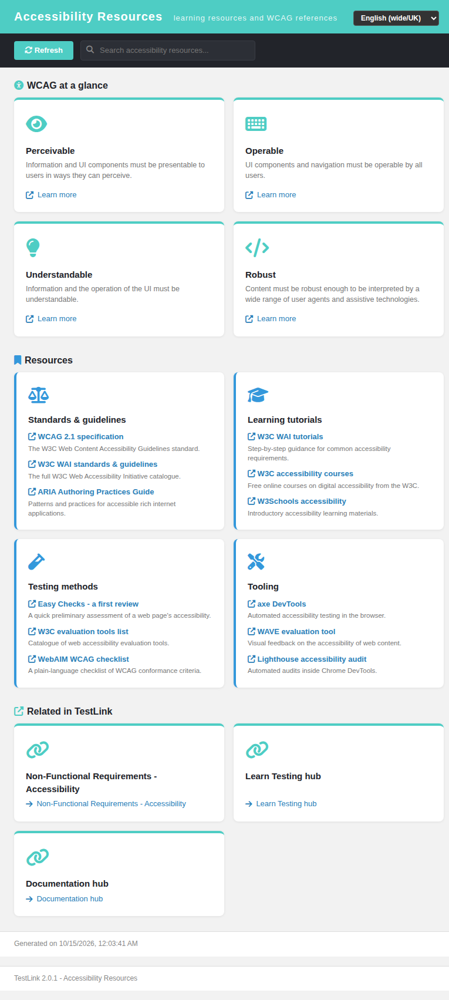
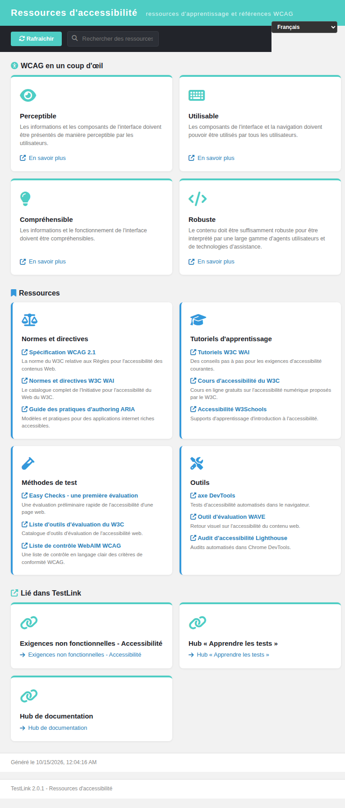

# Accessibility Resources hub — Modernized (TestLink 2.0.1, Refs #1059)

Net-new in-app **accessibility learning catalogue** for TestLink, added as the
Documentation ASIDE section's third entry (below **Documentation** and
**Learn Testing**). TestLink 1.9.20 shipped no accessibility hub, so this is a
2.0.1 enhancement rather than a legacy migration; it mirrors the #1060 Learn
Testing hub pattern.

## Why this screen

Issue #1059 asks for a discoverable Accessibility learning/reference area so
testers, developers and stakeholders can find the WCAG principles and the
authoritative W3C/WAI/WebAIM resources without leaving TestLink.

## Modern stack

| Layer | File |
|---|---|
| Screen | `gui/templates/documentation/accessibilityResources.html` (Dashio standalone HTML/JS/CSS) |
| BFF | `api/accessibilityresources/index.php` (`GET\|HEAD ?action=init`, session auth + same-origin guard) |
| Wiring | `$actions->accessibilityResources` in `lib/functions/common.php`, consumed by `api/aside/index.php` section 12 (Documentation) |
| i18n | `a11yres.*` (47 keys) + `footers.accessibilityResources` in **all 10** client bundles; `$TLS_title_accessibility_resources` in **all 19** server locales |

## Content

- **WCAG at a glance** — the four POUR principles (Perceivable, Operable,
  Understandable, Robust) as teal cards, each with a "Learn more" deep link to
  the W3C "Understanding the four principles" page.
- **Four resource groups** (12 resources, all authoritative bodies — no invented
  URLs):
  - **Standards & guidelines** — WCAG 2.1 specification, W3C WAI standards &
    guidelines, ARIA Authoring Practices Guide.
  - **Learning tutorials** — W3C WAI tutorials, W3C accessibility courses,
    W3Schools accessibility.
  - **Testing methods** — Easy Checks (first review), W3C evaluation tools
    list, WebAIM WCAG checklist.
  - **Tooling** — axe DevTools, WAVE evaluation tool, Lighthouse accessibility
    audit.
- **Related in TestLink** — in-context deep links to the NFR Accessibility
  chapter, the Learn Testing hub and the Documentation hub.

## Interactions

- **Live search** — a toolbar filter over principle titles/descriptions, group
  headings and resource labels/descriptions; matching principle cards and empty
  groups are hidden, with a distinct no-match empty state (`a11yres.noResults`).
- **Locale switcher** — the standard `TLi18n` switcher; the whole page follows
  the selected bundle.
- **Refresh** — reloads the hub from the BFF.

## BFF hardening

- Session auth (401 anonymous) + `bffSameOriginGuard()`; `GET|HEAD` only
  (405 on a same-origin POST, 403 on a foreign-origin write).
- Unknown/missing `action` → `400`.
- Returns `a11yres.*` **keys only** (no server-side hardcoded strings), so every
  label is translated client-side from the same bundles the rest of the UI uses.
- JSON headers + `no-store` caching.

## Wiring

`$actions->accessibilityResources` in `lib/functions/common.php` resolves to
`/gui/templates/documentation/accessibilityResources.html?<ctx>`;
`api/aside/index.php` section 12 renders it as the third Documentation item with
the server label `title_accessibility_resources`. The Documentation and Learn
Testing entries are unchanged.

## Verified

- **API contract**: 200 `action=init` → 4 principles + 4 groups (12 resources) +
  3 related links, all labels as `a11yres.*` keys; 401 anonymous; 400 unknown
  action; 405 same-origin POST; 403 foreign-origin.
- **Browser** (admin): 4 POUR cards + 4 groups + 12 resources + 3 related links
  render; search `wcag` → only the two WCAG-matching resources; Français switch
  → `Ressources d'accessibilité` + fully translated content; console clean
  (0 messages).
- **ASIDE**: `GET /api/aside/index.php?action=init` →
  `['documentationHub','learnTesting','accessibilityResources']` with the
  resolved href and `fas fa-universal-access` icon.
- **i18n**: all 10 client bundles valid JSON; `bash ai/verify_i18n_coverage.sh`
  → 9 passed / 0 failed (7675 keys); `$TLS_title_accessibility_resources`
  present in all 19 `locale/*/strings.txt` (all `php -l` clean).
- **Event Viewer**: no new Error/Warning.
- **Coverage suite**: `TLU_REQUIRE_SUITE="Issue #1059"` → 18 checks, gate
  `7 PASS / 0 FAIL`, 174 → 175 suites, none lost.

**Result: 18/18 PASS.**
