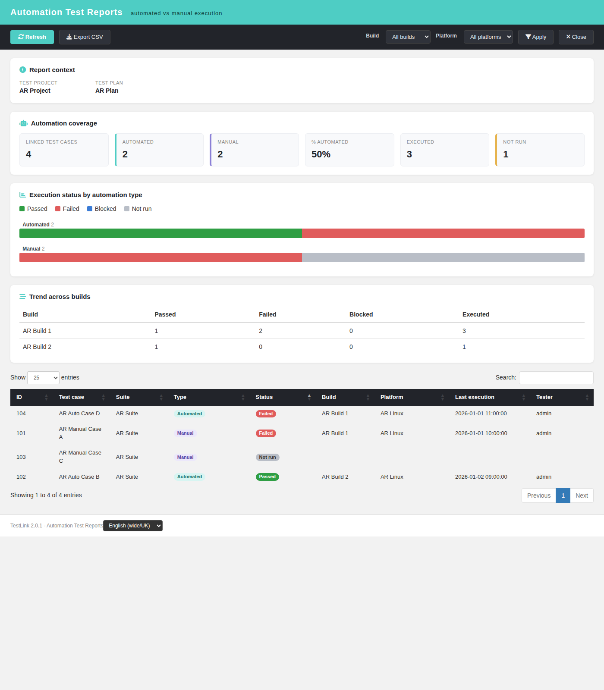
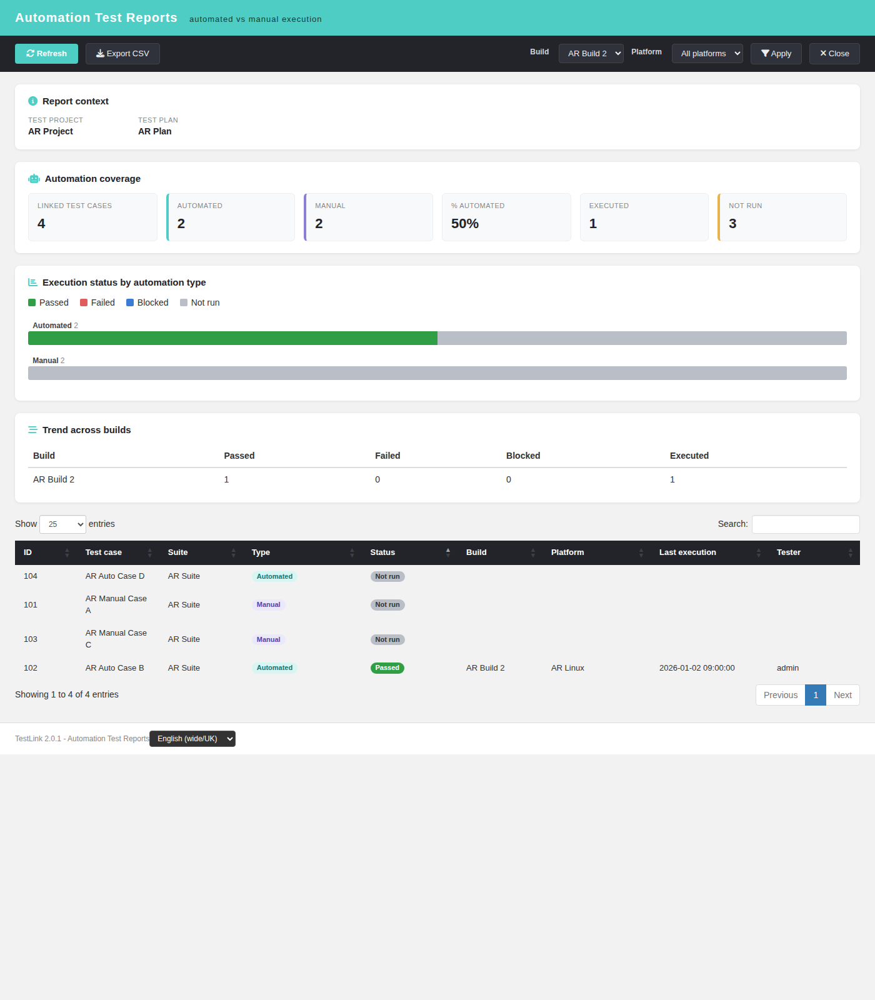
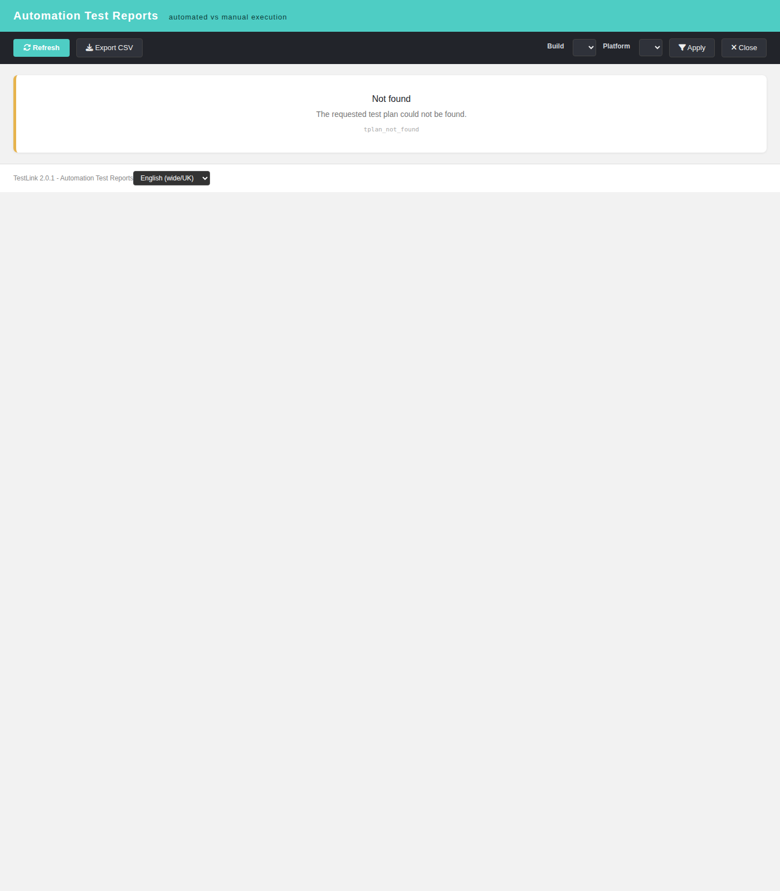

# Automation Test Reports — Modernized (TestLink 2.0.1, Refs #1062 / #1921)

Net-new **Automation Test Reports** screen for TestLink, added to the Reports
menu. TestLink 1.9.20 shipped no automation reporting at all: automated results
were written into the same `tl executions` table as manual ones and could only be
counted through the generic metrics/charts reports, which never split automated
from manual execution, never exposed the automated test-case inventory, the
per-build automation trend or a failed-automation worklist. This is therefore a
2.0.1 enhancement rather than a legacy migration — nothing is dropped, because
nothing existed.

## Why this screen

Issue #1062 asks for a dedicated **Reports › Automation Test Reports** page that
aggregates results received from automation frameworks / CI / external runners:
overall status, results grouped by test plan/build/platform, manual-vs-automated
coverage, a trend across builds and a worklist of failures. This screen delivers
the part that maps onto the existing schema (no new tables): the manual-vs-
automated split of the plan's linked test cases, the latest execution status per
test case version, a per-build trend and a filterable worklist with CSV export.

## Modern stack

| Layer | File |
|---|---|
| Screen | `gui/templates/results/automationReports.html` (Dashio standalone HTML/JS/CSS) |
| BFF | `api/automationreports/index.php` (`GET\|HEAD ?action=init\|report`) |
| Wiring | `cfg/reports.cfg.php` `automation_reports` + `api/aside/index.php` `link_report_automation_reports` |
| i18n | `autom.*` (57 keys) + `footers.automationReports` in **all 10** client bundles; `$TLS_link_report_automation_reports` in **all 19** server locales |

## BFF contract

| Method / route | Purpose | Notes |
|---|---|---|
| `GET\|HEAD ?action=init&tplan_id=N[&tproject_id=P]` | context + filter options | returns `context{tplan_id,tplan_name,tproject_id,tproject_name}` and `filters{builds[],platforms[]}` |
| `GET\|HEAD ?action=report&tplan_id=N[&tproject_id=P][&build_id=B][&platform_id=PL]` | the aggregate | returns `context`, `filters`, `filter`, `summary`, `build_trend[]`, `rows[]`, `rows_truncated` |

Error contract: `400 invalid_request`, `401 not_authenticated` / `session_expired`,
`403 no_right`, `404 tplan_not_found` / `project_mismatch`, `405 method_not_allowed`.

A `build_id` / `platform_id` that does not belong to the owning test project is
refused with `400 invalid_request` (never silently ignored — that would leak
counts from a foreign project).

## Semantics of the aggregate

- The unit is the **test-case version** linked to the test plan
  (`testplan_tcversions.tcversion_id`), because `execution_type` — manual vs
  automated — is a property of a version (`tcversions.execution_type`; 1 = manual,
  2 = automated).
- A linked version is counted **once** even when the plan links it on several
  platforms.
- The **latest recorded execution** of a version (per version + platform, across
  all builds unless a build is filtered) supplies the reported status; a version
  with no execution is **not run**. This mirrors the "absolute latest execution"
  convention of the legacy `neverRun` / `resultsByStatus` reports.
- `summary.automation_coverage` = automated linked versions / linked versions.
- `build_trend` is the same latest-per-(version, build) status counted per build
  (the "trend across builds" the enhancement asks for).

## Report content

- **Coverage strip** — linked test cases, automated, manual, % automated,
  executed, not run.
- **Status by automation type** — one stacked bar per automation type
  (passed / failed / blocked / not run) drawn with plain CSS.
- **Trend across builds** — a compact table: build, passed, failed, blocked,
  executed.
- **Worklist** — a sortable DataTable: ID, test case, suite, type, status, build,
  platform, last execution, tester.
- **Filters** — build and platform (project-scoped).
- **Export CSV** — the worklist (UTF-8 BOM, `;`-separated, with a spreadsheet
  formula-injection guard).

## Interactions

- **Refresh** — re-runs the report with the current filters.
- **Apply** — re-runs the report with the selected build/platform.
- **Export CSV** — downloads the worklist; a *Nothing to export yet* toast when
  the report is empty.
- **Close** — closes the window (same idiom as the sibling result screens).
- **Locale switcher** — the standard `TLi18n` switcher; the whole page follows the
  selected bundle (English + Romanian translated; the remaining bundles fall back
  to English, matching the rest of the results family).
- **State cards** — every BFF error code maps to a friendly title/body card, with
  the raw server message shown as an escaped detail.

## Hardening

- Session auth (401 anonymous) + `bffSameOriginGuard()` + `bffEnforceSession()`.
- `testplan_metrics` checked on the **owning** test project AND test plan with
  `getAccess = true` (a right held only globally does not reach a private test
  project), mirroring the accepted siblings `api/keywordbarchart`,
  `api/prioritybarchart`, `api/toplevelsuitesbarchart`.
- The plan is resolved first (opaque 404 `tplan_not_found`); the client's
  `tproject_id` is honoured only after the right check (`project_mismatch`).
- Strict positive-integer readers for every id (`1abc`, `1.9`, `-3`, `''` refused).
- `html_entity_decode()` on stored names; every BFF string is escaped client-side
  before it reaches the DOM; explicit `$_GET` reads (not `$_REQUEST`);
  `Cache-Control: no-store`.

## Verification

Fixture `tmp/fixtures_1921.sql`: public project *AR Project* (9100), plan
*AR Plan* (9130) with 4 linked versions (2 manual, 2 automated) + empty plan
*AR Empty Plan* (9131), build *AR Build 1*/*AR Build 2*, platform *AR Linux*.
Expected and measured (no filter): linked 4, automated 2, manual 2, %automated 50,
passed 1, failed 2, blocked 0, not run 1, executed 3; trend Build 1 → P1/F2/E3,
Build 2 → P1/F0/E1. Build filter → executed 1, not run 3. Empty plan → empty
state. `ai/verify_i18n_coverage.sh` 9/9 PASS. Event Viewer clean.
