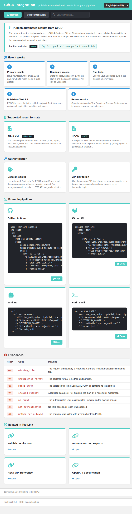

# CI/CD Integration hub — Modernized (TestLink 2.0.1, Refs #1940, parent #1064)

Net-new in-app **CI/CD Integration hub** for TestLink 2.0.1, the second screen of
parent feature [#1064](https://github.com/sebiboga/testlink-upgraded/issues/1064).
Its sibling — the **CI/CD Result Publishing** screen (`cicdPublish`) — is the
results half and already shipped; this is the *documentation* half: a single
place that explains the API-based publish workflow, the accepted result formats,
the auth options, the error contract and hands the integrator copy-ready pipeline
snippets. Tracking issue
[#1940](https://github.com/sebiboga/testlink-upgraded/issues/1940), parent feature
[#1064](https://github.com/sebiboga/testlink-upgraded/issues/1064).



## Why this screen

- Parent enhancement **#1064** (CI/CD integration: publish automated results).
  Its results screen (`cicdPublish`) was delivered earlier; the acceptance
  criterion *"document the workflow for integrators"* was still unmet.
- TestLink 1.9.20 shipped **no** CI/CD integration artifact, and neither did the
  initial 2.0.1 BFF layer — this is a genuine net-new Documentation-hub screen.
- Integrators previously had to read PHP source to discover the endpoint, the
  multipart field names, the auth header and the error codes; the hub surfaces
  all of it with copy-paste examples.

## Modern stack

| Layer | File |
|---|---|
| Screen | `gui/templates/documentation/cicdHub.html` (Dashio standalone HTML/JS/CSS) |
| BFF | `api/cicd/index.php` (`GET\|HEAD ?action=init`; session auth + same-origin guard + session-inactivity check) |
| Wiring | `$actions->cicdHub` in `lib/functions/common.php`, consumed by `api/aside/index.php` section 12 (Documentation) |
| i18n | `cicdhub.*` (69 keys) + `footers.cicdHub` in **all 10** client bundles; `$TLS_title_cicd_hub` in **all 19** server locales |

## Content

- **About this hub** — intro card with the live publish endpoint chip
  `api/cicdpublish/index.php?action=publish`.
- **How publishing works (5 steps)** — prepare results (JUnit XML / JSON) →
  authenticate (session cookie or API key) → POST multipart `file` to the publish
  endpoint → TestLink parses into a test plan/build → open Automation Test
  Reports. Each step is numbered and carries a short rationale.
- **Result formats** — the two accepted formats (JUnit XML, TestLink JSON),
  with what each supports and when to use it.
- **Authentication** — the two options (session cookie with the
  `X-Requested-With: XMLHttpRequest` CSRF header, or a per-plan API key), with
  the exact header shape.
- **Example pipelines** — four copy-ready snippets (GitHub Actions, GitLab CI,
  Jenkins, plain curl). Every snippet posts to `action=publish`, sends the report
  as the multipart field `file`, and carries the `X-Requested-With:
  XMLHttpRequest` header the shared CSRF guard requires.
- **Error codes** — seven documented failures (missing file, bad format, auth,
  forbidden, unknown action, oversized payload, server error) with cause and fix.
- **Related in TestLink** — deep links (current `tproject_id`/`tplan_id`,
  `target=_top`) to CI/CD Result Publishing, Automation Test Reports, the REST
  API Reference and the OpenAPI Specification.
- **Toolbar** — Refresh, Documentation (back), and a live filter over steps,
  formats, auth modes, examples, errors and related links, with a translated
  no-match state.

## State cards

Machine-code state cards replace raw failures: **401** (session — shows the
*Log in* action → `/login.php?note=expired`), **403**, **400**, **405** and
**500**, each with the translated message and the raw `HTTP nnn - code` line.
The page content is hidden while a state card is shown.

## BFF contract

`GET|HEAD /api/cicd/index.php?action=init` (default) →

```json
{ "status":"ok", "endpoint":"/api/cicdpublish/index.php?action=publish",
  "methods":["POST"], "steps":[...], "formats":[...], "authModes":[...],
  "examples":[{"id","title","lang","snippet"}...], "errors":[{"http","code","desc"}...],
  "related":[...] }
```

Errors: `400 unknown_action`, `401 not_authenticated|session_expired`,
`403 foreign-origin` (`bffSameOriginGuard()`), `405 method_not_allowed`. Every
screen label is returned as an **i18n key** (`cicdhub.*`); the example snippets
are plain DATA and are rendered client-side through `.text()` (never `innerHTML`),
so a snippet can never inject markup.

## Verification

- Browser suite **Issue #1940 = 23/23 PASS** (append-only suite in
  `tmp/TLU_Test_Cases.md`; gate `TLU_REQUIRE_SUITE="Issue #1940"
  bash ai/verify_test_suites.sh` → 34 PASS / 0 FAIL, no suite lost).
- `bash ai/verify_i18n_coverage.sh` → 9/9 bundles, 8975 keys, 0 missing.
- BFF curl matrix: anon 401, authed init 200, HEAD 200, bad action 400,
  authed POST 405, foreign-origin POST 403.
- Event Viewer clean (no Error/Warning rows).
- Console clean on the screen; inline script validated with `node --check`,
  BFF with `php -l`.

## Notes

- The example snippets are deliberately plain text (not localized): they are
  shell/YAML code an integrator copy-pastes, and translating them would break
  them. The UI around them is fully localized.
- The four snippets are the canonical shapes the `cicdPublish` screen accepts, so
  the hub and the publish screen can never drift on the wire contract.
