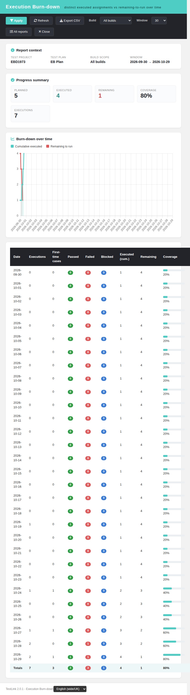
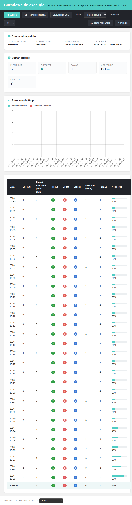
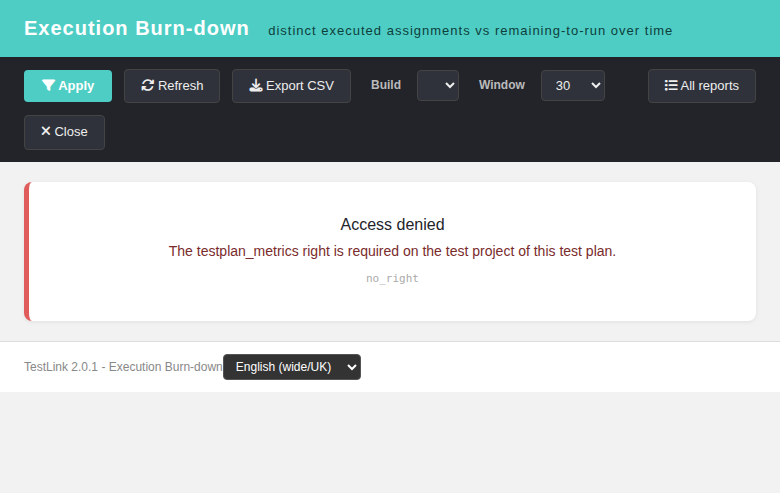

# Test Plan Execution Burn-down (Modernized) — Issue #1973

The modern Dashio page **`gui/templates/results/execBurnDown.html`**, backed by
the read-only BFF **`api/execburndown/index.php`**, is a **net-new 2.0.1 report**:
every 1.9.20 report is a point-in-time snapshot and the only time axis was the
per-build strip of `metricsTrends`. This screen answers "is the remaining-to-run
line actually going down?" for a whole test plan, with an optional build scope.

## Layout
- **Header** (teal Dashio) with the report title and the locale switcher in the footer.
- **Toolbar**: Build scope, Window (7/14/30/60/90/180/365 days), Apply,
  Refresh, **Export CSV**, All reports, Close.
- **Report context** card: test project, test plan, build scope, window range.
- **Progress summary** cards: Planned, Executed, Remaining, Coverage, Executions.
- **Burn-down chart**: two series — Cumulative executed (teal, rising) and
  Remaining to run (red, falling).
- **Daily table** (DataTable): Date, Executions, First-time cases, Passed,
  Failed, Blocked, Cumulative, Remaining, Coverage, plus a **Totals** row.
- **State cards**: Missing context / Access denied / Not found / Invalid request /
  Server error with the BFF machine code.

## Semantics (computed by the BFF, the client only renders it)
- **Planned** = distinct `(tcversion, platform)` assignment rows of the plan
  (`testplan_tcversions`), the same universe the execution screens use.
- An execution only counts when its `(tcversion, platform)` pair is still
  assigned to the plan.
- **Executed / cumulative** = distinct `(tcversion, platform)` pairs with at
  least one execution up to and including that day; a rerun does not move the
  line twice.
- **Executions** = raw execution rows recorded that day (reruns included);
  **First-time cases** = pairs executed for the first time that day.
- **Build scope** filters the executions only, never the planned universe.
- **Window** is the last N days (1..365, default 30) ending today; the cumulative
  baseline still counts executions recorded before the window.
- **Totals / Executions KPI / CSV totals describe the emitted window** (bug
  #1974 fix): they are summed from the day rows, not from the plan lifetime.

## Data model (BFF `api/execburndown/index.php`)
- **Routes**: `GET|HEAD ?action=init&tplan_id=N[&tproject_id=P]` and
  `?action=report&tplan_id=N[&tproject_id=P][&build_id=B][&days=D]`. No write verb.
- **Rights**: `testplan_metrics` on the **owning** project of the plan; the
  caller's `tproject_id` is asserted only (project mismatch → 404).
- **Error contract**: `400 invalid_request`, `401 not_authenticated|session_expired`,
  `403 no_right`, `404 tplan_not_found|project_mismatch`, `405 method_not_allowed`.
- **Build validation**: an unknown build id is rejected as `404 tplan_not_found`
  (opaque, no oracle for other plans' builds).
- Baseline before the window keeps the first emitted cumulative point meaningful;
  an empty build/window renders the "Nothing to plot" empty state.

## Wiring
- `cfg/reports.cfg.php` — `$tlCfg->reports_list['exec_burndown']` with title
  `link_report_exec_burndown` and URL `gui/templates/results/execBurnDown.html`.
- `api/aside/index.php` — ASIDE Reports entry for `link_report_exec_burndown`.
- `api/resultsnav/index.php` — `exec_burndown` maps to the modern page.
- `lib/functions/common.php` — `$actions->execBurnDown` with project/plan context.
- Client i18n `ebd.*` (52 keys) + `footers.execBurnDown` in all 10 bundles;
  server `$TLS_link_report_exec_burndown` in all 19 locales.

## Bugs found and fixed while testing
1. **#1974** — the Totals row, the Executions KPI and the CSV totals were
   accumulated over the whole plan, so a 7-day window still reported the plan
   lifetime. Totals are now recomputed from the emitted day rows; the per-day
   counters and the pre-window baseline are unchanged.

## Screenshots

