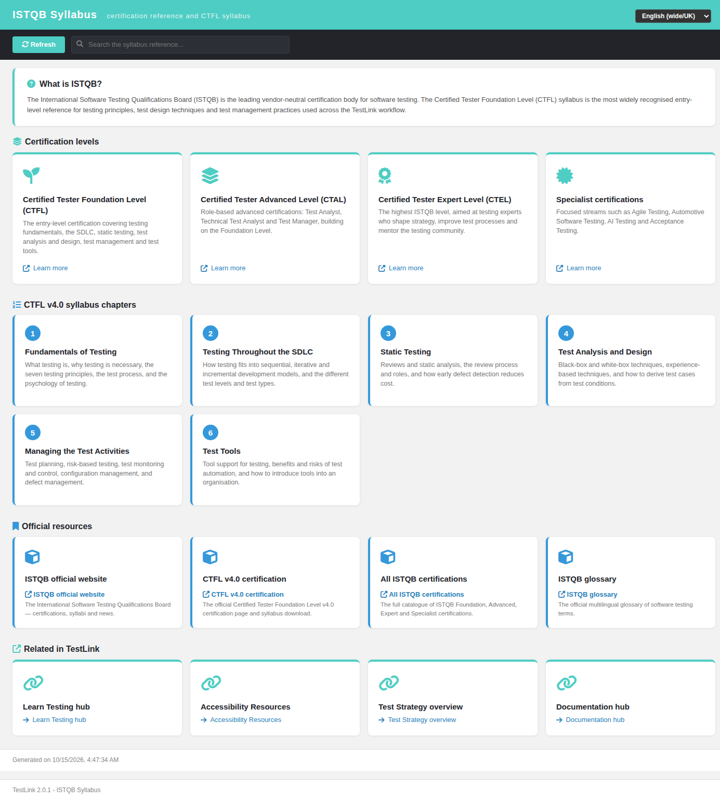

# ISTQB Syllabus hub — Modernized (TestLink 2.0.1, Refs #1053)

Net-new in-app **ISTQB certification reference + CTFL v4.0 syllabus hub** for
TestLink, added as the Documentation ASIDE section's fourth entry (below
**Documentation**, **Learn Testing** and **Accessibility Resources**). TestLink
1.9.20 shipped no such screen, so this is a 2.0.1 enhancement rather than a
legacy migration; it mirrors the #1059 Accessibility Resources hub and the #1060
Learn Testing hub patterns.

## Why this screen

Issue #1053 asks for a discoverable, official ISTQB reference inside TestLink so
testers can reach the certification levels, the CTFL v4.0 syllabus structure and
the authoritative istqb.org resources (syllabi, certification pages, glossary)
without leaving the application.

## Modern stack

| Layer | File |
|---|---|
| Screen | `gui/templates/documentation/istqbSyllabus.html` (Dashio standalone HTML/JS/CSS) |
| BFF | `api/istqb/index.php` (`GET\|HEAD ?action=init`, session auth + same-origin guard) |
| Wiring | `$actions->istqbSyllabus` in `lib/functions/common.php`, consumed by `api/aside/index.php` section 12 (Documentation) |
| i18n | `istqb.*` (43 keys) + `footers.istqbSyllabus` in **all 10** client bundles; `$TLS_title_istqb_syllabus` in **all 19** server locales |

## Content

- **What is ISTQB?** — an intro card explaining the vendor-neutral certification
  body and the CTFL Foundation Level syllabus.
- **Certification levels** (4 cards, each linking to the official istqb.org page):
  Certified Tester Foundation Level (CTFL), Advanced Level (CTAL), Expert Level
  (CTEL) and the Specialist certifications.
- **CTFL v4.0 syllabus chapters** (6 numbered cards): Fundamentals of Testing,
  Testing Throughout the SDLC, Static Testing, Test Analysis and Design, Managing
  the Test Activities, Test Tools.
- **Official resources** (4 external links, all authoritative — no invented URLs):
  istqb.org home, the CTFL v4.0 certification page, the full certification
  catalogue and the official ISTQB glossary.
- **Related in TestLink** — in-context deep links to the Learn Testing hub, the
  Accessibility Resources hub, the Test Strategy overview and the Documentation
  hub.

## Interactions

- **Live search** — a toolbar filter over level titles/descriptions, chapter
  titles/descriptions and resource labels/descriptions; matching cards are hidden
  and a distinct no-match empty state (`istqb.noResults`) is shown only when every
  section is empty.
- **Locale switcher** — the standard `TLi18n` switcher; the whole page follows
  the selected bundle (English + Romanian + German + Spanish + French + Italian +
  Portuguese + Russian translated, Japanese/Chinese fall back to English).
- **Refresh** — reloads the hub from the BFF.

## BFF hardening

- Session auth (401 anonymous) + `bffSameOriginGuard()`; `GET|HEAD` only
  (405 on a same-origin POST, 403 on a foreign-origin write).
- Unknown/missing `action` → `400`.
- Returns `istqb.*` **keys only** (no server-side hardcoded strings), so every
  label is translated client-side from the same bundles the rest of the UI uses.
- JSON headers + `no-store` caching.

## Wiring

`$actions->istqbSyllabus` in `lib/functions/common.php` resolves to
`/gui/templates/documentation/istqbSyllabus.html?<ctx>`; `api/aside/index.php`
section 12 renders it as the fourth Documentation item with the server label
`title_istqb_syllabus`. The Documentation, Learn Testing and Accessibility
Resources entries are unchanged.

## Verified

- **API contract**: 200 `action=init` → 4 levels + 6 chapters + 4 resources +
  4 related links, all labels as `istqb.*` keys; 401 anonymous; 400 unknown
  action; 405 same-origin POST; 403 foreign-origin.
- **Browser** (admin): 4 level cards + 6 chapter cards + 4 resource cards + 4
  related links render; search `static` → 1 level + 1 chapter; a no-match query
  shows the empty state and clearing restores all; Română switch → `Programa
  ISTQB`, Deutsch switch → `ISTQB-Lehrplan`, Chinese → English fallback with no
  raw keys; console clean (0 messages).
- **ASIDE**: `GET /api/aside/index.php?action=init` →
  `['documentationHub','learnTesting','accessibilityResources','istqbSyllabus']`
  with the resolved href and `fas fa-certificate` icon.
- **i18n**: all 10 client bundles valid JSON; `bash ai/verify_i18n_coverage.sh`
  → 9 passed / 0 failed (7719 keys); `$TLS_title_istqb_syllabus` present in all 19
  `locale/*/strings.txt` (all `php -l` clean).
- **Event Viewer**: no new Error/Warning.
- **Coverage suite**: `TLU_REQUIRE_SUITE="Issue #1053"` → 24 checks, none lost.

**Result: 24/24 PASS.**
