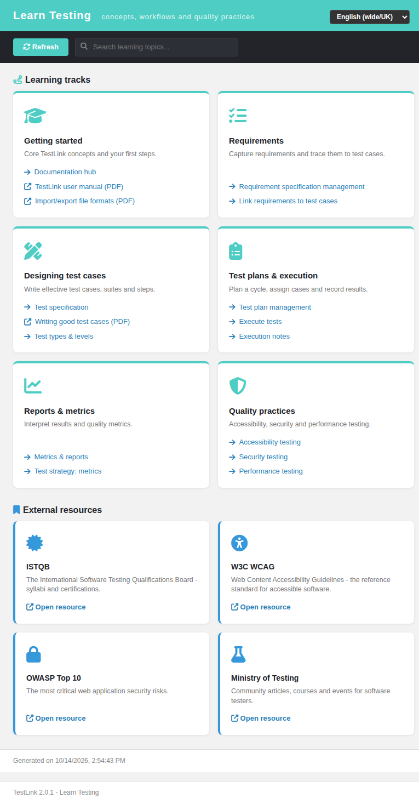
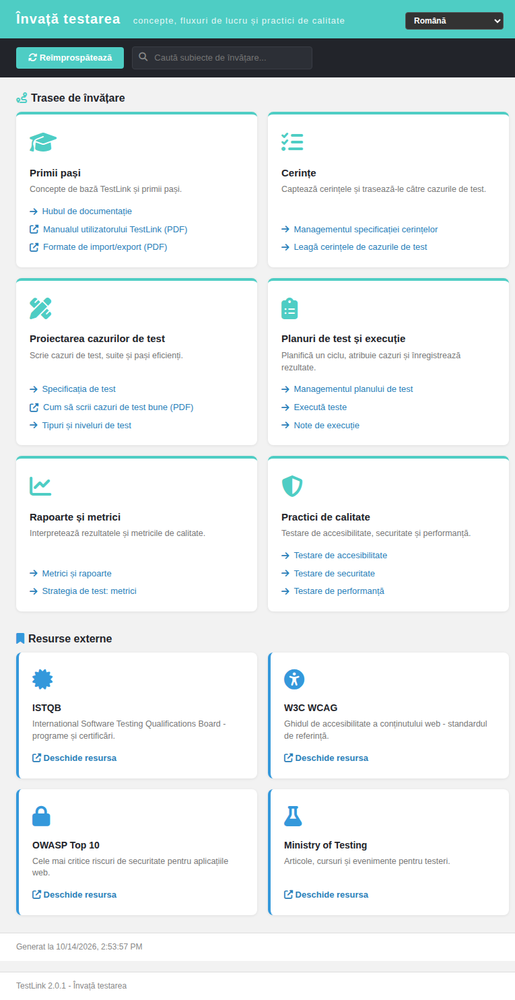

# Learn Testing hub — Modernized (TestLink 2.0.1, Refs #1060)

Net-new in-app **learning area** for TestLink, added as the Documentation ASIDE
section's second entry (below **Documentation**). TestLink 1.9.20 shipped no
learning screen, so this is a 2.0.1 enhancement rather than a legacy migration.

## Why this screen

With the TODO ledger empty and every ASIDE entry already mapped to a modern
`.html` + BFF, the run took the oldest open Documentation-area enhancement:
issue #1060, which asks for a discoverable "Learn Testing" hub so TestLink is
not only a test-management platform but also a practical learning entry point
for new testers, developers and stakeholders.

## Modern stack

| Layer | File |
|---|---|
| Screen | `gui/templates/documentation/learnTesting.html` (Dashio standalone HTML/JS/CSS) |
| BFF | `api/learntesting/index.php` (`GET\|HEAD ?action=init`, session auth + same-origin guard) |
| Wiring | `$actions->learnTesting` in `lib/functions/common.php`, consumed by `api/aside/index.php` section 12 (Documentation) |
| i18n | `learn.*` (47 keys) + `footers.learnTesting` in **all 10** client bundles; `$TLS_title_learn_testing` in **all 19** server locales |

## Content

- **Six learning tracks** (cards, teal accent): Getting started, Requirements,
  Test design, Test plans & execution, Reports & metrics, Quality practices.
  - 13 internal links deep-link the modern screens in the **current project /
    plan context** (e.g. `reqSpecMgmt.html`, `testSpec.html`, `execTest.html`,
    `resultsNavigator.html`, `strategy/nfr*.html`).
  - 3 links open the shipped PDF manuals (`testlink_user_manual.pdf`,
    `tl-file-formats.pdf`, `GoodTest.pdf`), opened in a new tab.
- **Four external resource cards** (blue accent): ISTQB, W3C WCAG, OWASP Top 10,
  Ministry of Testing — authoritative bodies only, no invented URLs.

## Interactions

- **Live search** — a toolbar filter over track titles, descriptions and link
  labels; a distinct no-match empty state (`learn.noResults`).
- **Locale switcher** — the standard `TLi18n` switcher; the whole page follows
  the selected bundle.
- **Refresh** — reloads the hub from the BFF.

## BFF hardening

- Session auth (401 anonymous) + `bffSameOriginGuard()`; `GET|HEAD` only.
- Unknown/missing `action` → `400`; foreign-origin write → `403`.
- Returns `learn.*` **keys only** (no server-side hardcoded strings), so every
  label is translated client-side from the same bundles the rest of the UI uses.
- JSON headers + `no-store` caching.

## Wiring

`$actions->learnTesting` in `lib/functions/common.php` resolves to
`/gui/templates/documentation/learnTesting.html?<ctx>`; `api/aside/index.php`
section 12 renders it as the second Documentation item with the server label
`title_learn_testing`. The Documentation hub itself is unchanged.

## Verified

- **API contract**: 200 `action=init` → 6 tracks / 16 items (13 internal / 3
  external) + 4 resources; 401 anonymous; 400 unknown action; 403 foreign-origin.
- **Browser** (admin): 6 track cards + 4 resource cards render; search `security`
  → only "Quality practices"; no-match empty state; Română switch → `Învață
  testarea` / `Primii pași`; clicking an internal card navigates to
  `testSpec.html` with context; console clean (0 messages).
- **i18n**: all 10 client bundles valid JSON; `bash ai/verify_i18n_coverage.sh`
  → 9 passed / 0 failed (7625 keys); `$TLS_title_learn_testing` present in all
  19 `locale/*/strings.txt`.
- **Event Viewer**: no new Error/Warning.
- **Coverage suite**: `TLU_REQUIRE_SUITE="Issue #1060"` → 7 PASS / 0 FAIL,
  167 → 168 suites, none lost.

**Result: 16/16 PASS.**
