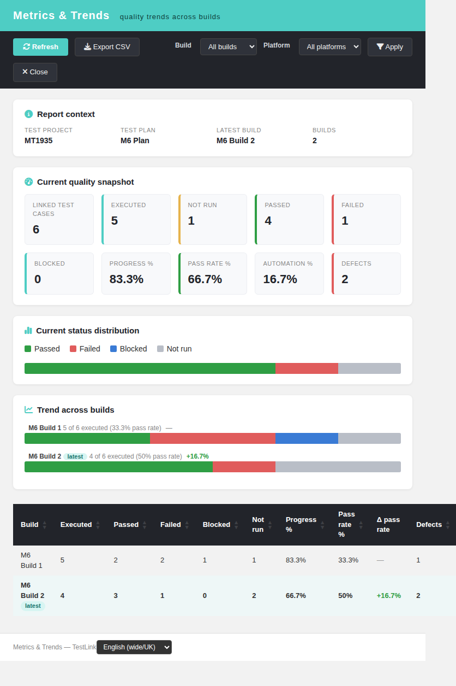
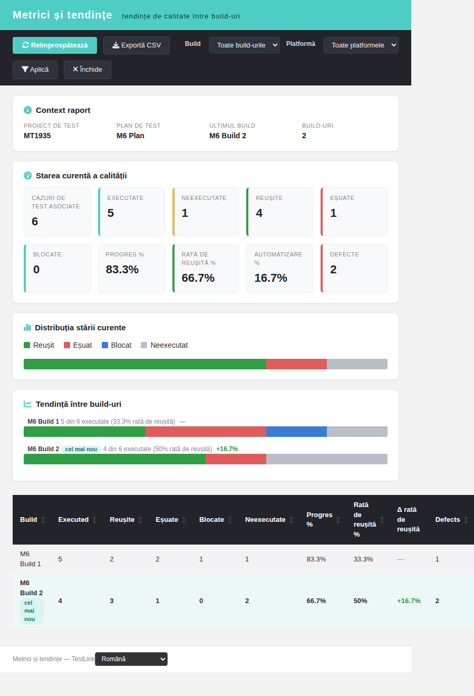
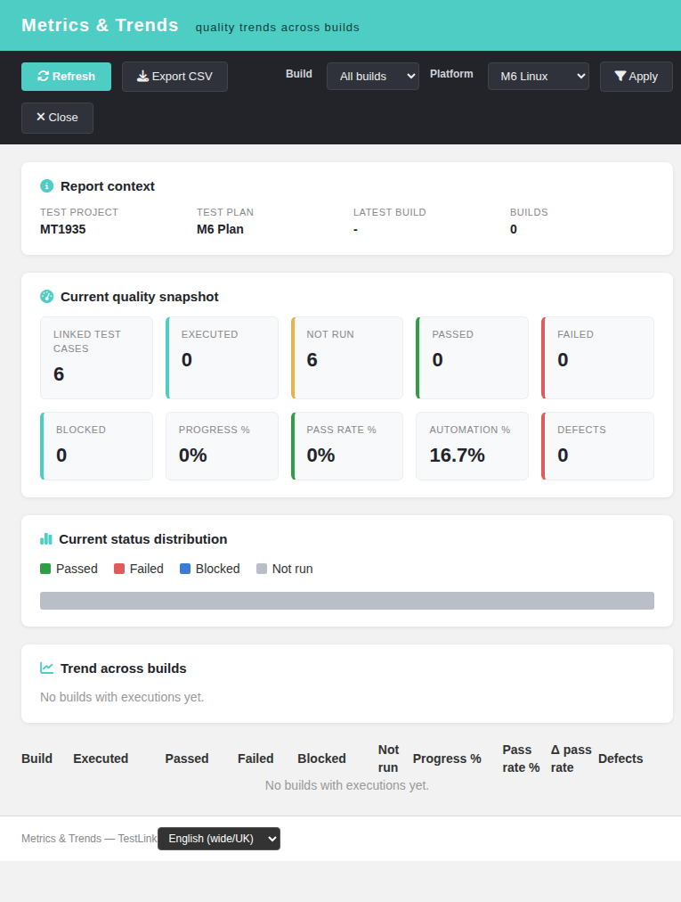
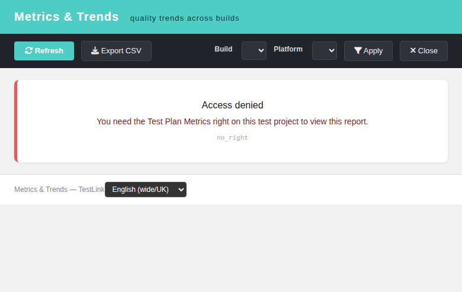

# Metrics & Trends — Modernized (TestLink 2.0.1, Refs #1935 / #1073)

Net-new **Metrics & Trends** dashboard for TestLink, added to the Reports menu.
TestLink 1.9.20 exposed a **snapshot** only: the Test Plan Metrics screen
(`generalMetrics` / `metricsDashboard`, modernized as
`gui/templates/results/metricsDashboard.html`) shows the *current* status of one
test plan and nothing rendered a **longitudinal** quality view across the plan's
builds. Issue #1073 ("Add Metrics & Trends dashboards for builds, releases and
defects") asks for exactly that trend view; this screen delivers the part that
maps onto the existing schema with **no new tables**. It is therefore a 2.0.1
enhancement rather than a legacy migration — nothing is dropped, because nothing
existed.

## Why this screen

The dashboard answers three questions in one page:

1. **Where does the plan stand now?** — a current-state snapshot (linked test
   cases, executed / not run / passed / failed / blocked, progress %,
   pass rate %, automation %, linked defects).
2. **Is quality improving?** — a per-build **trend** (executions by status,
   progress %, pass rate %, Δ pass rate vs the previous build and linked
   defects), with the newest build flagged.
3. **How much defect signal is there?** — distinct defect references
   (`execution_bugs.bug_id`) attached to the filtered executions.

## Modern stack

| Layer | File |
|---|---|
| Screen | `gui/templates/results/metricsTrends.html` (Dashio standalone HTML/JS/CSS) |
| BFF | `api/metricstrends/index.php` (`GET\|HEAD ?action=init\|report`) |
| Wiring | `cfg/reports.cfg.php` `metrics_trends` + `api/aside/index.php` `link_report_metrics_trends` + `$actions->metricsTrends` |
| i18n | `mt.*` (61 keys) + `footers.metricsTrends` in **all 10** client bundles; `$TLS_link_report_metrics_trends` in **all 19** server locales |

## BFF contract

| Method / route | Purpose | Notes |
|---|---|---|
| `GET\|HEAD ?action=init&tplan_id=N[&tproject_id=P]` | context + filter options | returns `context{tplan_id,tplan_name,tproject_id,tproject_name}` and `filters{builds[],platforms[]}` |
| `GET\|HEAD ?action=report&tplan_id=N[&tproject_id=P][&build_id=B][&platform_id=PL]` | the aggregate | returns `context`, `filters`, `filter{build_id,platform_id}`, `summary`, `build_trend[]` |

Error contract: `400 invalid_request`, `401 not_authenticated` /
`session_expired`, `403 no_right`, `404 tplan_not_found` / `project_mismatch`,
`405 method_not_allowed`.

A `build_id` / `platform_id` that does not belong to the owning test project is
refused with `400 invalid_request` (never silently ignored — that would leak
counts from a foreign project).

## Semantics of the aggregate

- The unit is the **test-case version** linked to the test plan
  (`testplan_tcversions.tcversion_id`), counted **once** even when the plan links
  it on several platforms.
- `summary` is the **current known state**: the **latest recorded execution** of
  a version (across all builds unless a build is filtered) supplies the reported
  status; a version with no execution is **not run**. This mirrors the "absolute
  latest execution" convention of the accepted siblings `api/automationreports`
  and `api/defectintelligence`.
- `build_trend` is the **same latest-per-(version, build)** status counted per
  build, ordered by build id (creation order), each row carrying `not_run`,
  `progress_pct`, `pass_rate_pct`, a `delta_pass_rate` vs the previous build and
  an `is_latest` flag on the newest build.
- Statuses map `p → passed`, `f → failed`, `b → blocked`, anything else / no
  execution → `not_run` (byte-identical to the results family).
- `defects` = `COUNT(DISTINCT execution_bugs.bug_id)` over the filtered
  executions (`bug_id` is a varchar, so a distinct count — never a numeric sum).

## Report content

- **Report context** — test project, test plan, latest build, build count.
- **Current quality snapshot** — linked test cases, executed, not run, passed,
  failed, blocked, progress %, pass rate %, automation %, defects.
- **Current status distribution** — a compact CSS bar per status.
- **Trend across builds** — card strip (progress + delta) **and** a sortable
  DataTable (build, executed, passed, failed, blocked, not run, progress %,
  pass rate %, Δ pass rate, defects).
- **Filters** — build and platform (project-scoped).
- **Export CSV** — the trend table (UTF-8 BOM, `;`-separated, with a spreadsheet
  formula-injection guard).

## Interactions

- **Refresh** / **Apply** — re-run the report with the current filters.
- **Export CSV** — downloads the trend table; a *Nothing to export* toast when
  the trend is empty.
- **Close** — closes the window (same idiom as the sibling result screens).
- **Locale switcher** — the standard `TLi18n` switcher; the whole page follows
  the selected bundle (English + Romanian + German + Spanish + French + Italian +
  Portuguese + Russian translated; Japanese + Chinese fall back to English,
  matching the rest of the results family).
- **State cards** — every BFF error code maps to a friendly title/body card, with
  the raw server message shown as an escaped detail. The empty trend renders a
  single full-width row and DataTables is *not* re-initialized on it (otherwise
  the library aborts with `Incorrect column count`, tn/18).

## Hardening

- Session auth (401 anonymous) + `bffSameOriginGuard()` + `bffEnforceSession()`.
- `testplan_metrics` checked on the **owning** test project AND test plan with
  `getAccess = true` (a right held only globally does not reach a private test
  project), mirroring the accepted siblings `api/automationreports`,
  `api/keywordbarchart`, `api/qualitygate`.
- The plan is resolved first (opaque 404 `tplan_not_found`); the client's
  `tproject_id` is honoured only after the right check (`project_mismatch`).
- Strict positive-integer readers for every id (`1abc`, `1.9`, `-3`, `''`
  refused).
- `html_entity_decode()` on stored names; every BFF string is escaped client-side
  before it reaches the DOM; explicit `$_GET` reads (not `$_REQUEST`);
  `Cache-Control: no-store`.

## Verification

Fixture `tmp/fixtures_1935.php`: project *MT1935* (prefix M6), plan *M6 Plan* (2)
with 6 linked versions (1 automated), builds *M6 Build 1*/*M6 Build 2*, platform
*M6 Linux* (no executions), defects *M6-BUG-1*/*M6-BUG-2*, and a role-3 user for
the 403 path. Expected and measured (no filter): linked 6, executed 5, not run 1,
passed 4, failed 1, blocked 0, progress 83.3, pass rate 66.7, fail rate 16.7,
automation 16.7, defects 2; trend Build 1 → P2/F2/B1, pass 33.3; Build 2 →
P3/F1, pass 50.0, Δ +16.7, latest. Build filter → b1 only; platform filter (no
executions) → all not-run + empty trend; 400/401/403/404/405 matrix exact;
`ai/verify_i18n_coverage.sh` 9/9 PASS; browser render + build/platform Apply +
CSV export + Romanian locale + denied state verified; Event Viewer clean (0
ERROR/WARNING).
