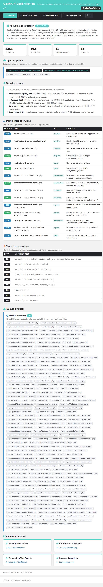

# OpenAPI Specification viewer — Modernized (TestLink 2.0.1, Refs #1944, parent #1072)

Net-new in-app **OpenAPI 3.1 specification** viewer/publisher for TestLink 2.0.1,
added as the Documentation ASIDE section's seventh entry (below **Documentation**,
**Learn Testing**, **Accessibility Resources**, **Accessibility Review**,
**ISTQB Syllabus** and **REST API Reference**). TestLink 1.9.20 shipped no
machine-readable API artifact at all, and neither did the 2.0.1 BFF layer — this
screen *generates* a real OpenAPI document from the live installation and serves
it as JSON or YAML. Tracking issue
[#1944](https://github.com/sebiboga/testlink-upgraded/issues/1944), parent feature
[#1072](https://github.com/sebiboga/testlink-upgraded/issues/1072).



## Why this screen

- Parent enhancement **#1072** (documented REST API / OpenAPI / webhooks). Its
  REST-reference half was closed by the #1937 `apiReference` hub; the acceptance
  criterion *"Publish an OpenAPI specification"* was still unmet.
- The ledger's TODO section is empty (every ASIDE entry already maps to a modern
  `.html` + BFF), so a genuine net-new Documentation-hub screen was taken instead
  of a legacy port.
- Integrators need a machine-readable contract they can feed to Swagger UI,
  Redoc, code generators or CI tooling — not just a human-readable page.

## Modern stack

| Layer | File |
|---|---|
| Screen | `gui/templates/documentation/openApiSpec.html` (Dashio standalone HTML/JS/CSS) |
| BFF | `api/openapi/index.php` (`GET\|HEAD ?action=init`, `GET\|HEAD ?action=spec[&format=json\|yaml]`; session auth + same-origin guard + session-inactivity check) |
| Wiring | `$actions->openApiSpec` in `lib/functions/common.php`, consumed by `api/aside/index.php` section 12 (Documentation) |
| i18n | `oas.*` (53 keys) + `footers.openApiSpec` in **all 10** client bundles; `$TLS_title_openapi_spec` in **all 19** server locales |

## Content

- **About this specification** — intro card with a live `OpenAPI 3.1.0` badge.
- **Metric tiles** — API version, BFF module count, documented path count and
  operation count, all read from the generated document.
- **Spec endpoints** — the two live routes
  `/api/openapi/index.php?action=spec` (JSON) and `…&format=yaml`, both with a
  download disposition.
- **Security scheme** — the shared request contract: `sessionCookie`
  (`apiKey` in cookie `PHPSESSID`), the `X-Requested-With: XMLHttpRequest`
  CSRF header on state-changing verbs, same-origin enforcement and session
  inactivity.
- **Documented operations** — the 15 curated integrator operations
  (auth, aside, projects, plans, test case edit, set results, results import,
  CI/CD publish, attachments, reports, self-description) with method, path, tag
  and summary.
- **Shared error envelope** — the nine HTTP statuses (400/401/403/404/405/409/
  413/422/500) and their stable machine codes, as exported in
  `components.responses`.
- **Module inventory** — every BFF module on this installation (162 today),
  exported in the spec as `x-testlink-modules`; the list is produced by globbing
  `api/<area>/index.php`, so it can never drift from reality.
- **Related in TestLink** — deep links (current `tproject_id`/`tplan_id`,
  `target=_top`) to the REST API Reference, CI/CD Result Publishing,
  Automation Test Reports and the Documentation hub.
- **Toolbar** — Refresh, Download JSON, Download YAML, Copy spec URL and a live
  filter over operations, paths and modules with a translated no-match state.

## State cards

Machine-code state cards replace raw failures: **401** (session — shows the
*Log in* action → `/login.php?note=expired`), **403**, **400**, **405** and
**500**, each with the translated message and the raw `HTTP nnn - code` line.
The page content is hidden while a state card is shown.

## BFF contract

`GET|HEAD /api/openapi/index.php?action=init` (default) →

```json
{ "status":"ok", "auth":{...}, "ctx":"tproject_id=..&tplan_id=..",
  "specMeta":{"openapi":"3.1.0","version":"2.0.1","moduleCount":162,
              "pathCount":11,"opCount":15,"specUrl":"...","specUrlYaml":"..."},
  "featured":[{"method","path","tag","summary"}...], "errors":[{"http","codes"}...],
  "related":[...], "modules":["/api/.../index.php"...] }
```

`GET|HEAD ?action=spec[&format=json|yaml]` → the OpenAPI 3.1 document
(`application/json` or `text/yaml`, `Content-Disposition: attachment`):

```json
{ "openapi":"3.1.0", "info":{...}, "servers":[...], "tags":[...],
  "paths":{...}, "components":{"securitySchemes":{"sessionCookie":{...}},
  "schemas":{"Error","JsonObject"},"responses":{"E400".."E500"}},
  "security":[...], "x-testlink-contract":{...}, "x-testlink-modules":[...] }
```

Errors: `400 unknown_action|bad_format`, `401 not_authenticated|session_expired`,
`403 foreign-origin` (`bffSameOriginGuard()` on state-changing methods only),
`405 method_not_allowed`. Every screen label is returned as an **i18n key**
(`oas.*`); the spec document itself is machine-facing English by design.

## Verification

- Browser suite **Issue #1944 = 19/19 PASS** (append-only suite in
  `tmp/TLU_Test_Cases.md`; gate `TLU_REQUIRE_SUITE="Issue #1944"
  bash ai/verify_test_suites.sh` → 34 PASS / 0 FAIL, no suite lost).
- `bash ai/verify_i18n_coverage.sh` → 9/9 bundles, 8842 keys, 0 missing.
- YAML output parses with PyYAML (`paths=11`, `openapi=3.1.0`).
- Event Viewer clean (only `LOGIN` AUDIT rows, no Error/Warning).
- Console clean on the screen; inline script validated with `node --check`.

## Notes

- The spec's `info`, `tags` and path summaries are deliberately English — an
  OpenAPI document is a technical artifact for tools, not a UI surface. The UI
  around it is fully localized.
- The module inventory is discovered from the filesystem (same authoritative
  source as the `apiReference` hub), so a newly added BFF module shows up in the
  spec automatically.
