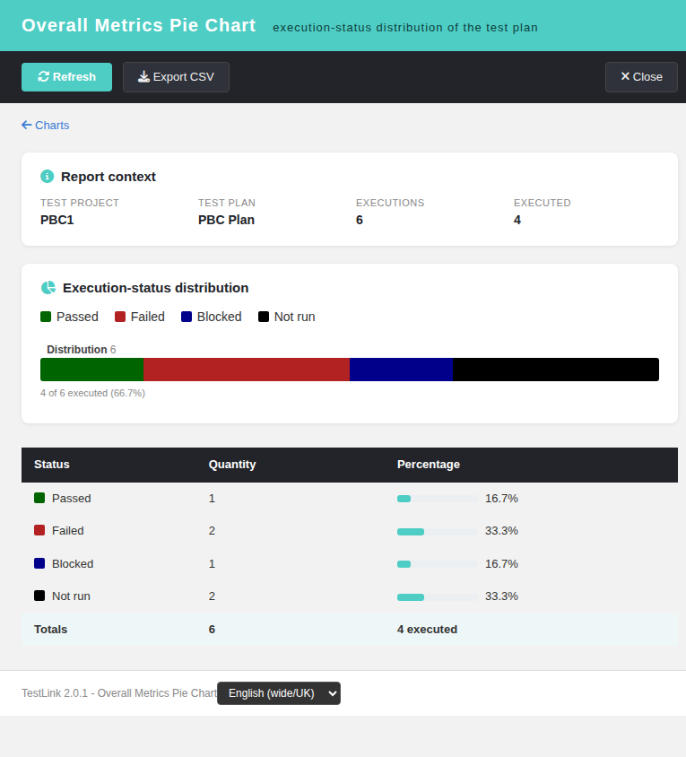

# Overall Metrics Pie Chart (Refs #1907)

Screen: `gui/templates/results/overallPieChart.html` ·
BFF: `api/overallpiechart/index.php` (`GET|HEAD ?action=init&tplan_id=N[&tproject_id=P]`) ·
Issue: #1907

## The last orphan Results chart endpoint

The ASIDE ledger (`docs/MODERNIZATION-STATUS.md`) showed **TODO = 0** — every screen
reachable from the ASIDE menu is already a modern Dashio page + REST BFF. A fresh audit of
the remaining `lib/**/*.php` controllers against `api/` + `gui/templates/**/*.html` found
the **last member of the pChart PNG chart family without a dedicated modern twin**:
`lib/results/overallPieChart.php`. Its four siblings already have standalone report pages —
`platformPieChart.html` (**#1906**), `priorityBarChart.html` (**#1845**),
`keywordBarChart.html` (**#1906**) and `topLevelSuitesBarChart.html` (**#1905**) — but the
**overall** execution-status distribution was only drawn as pixels by the modern Graphical
Charts screen (`charts.html` → `api/reports` `charts_data`), with no per-status numbers,
no totals row and no CSV export.

| Evidence | Finding |
| --- | --- |
| ASIDE/Reports hub audit | `api/resultsnav/index.php` maps every report key to a modern `gui/templates/**/*.html`; no legacy `lib/results/` URL remains |
| `charts_data` payload (`api/reports`) | returns `overall`, `by_platform`, `by_keyword`, `by_suite` — the **pixels** of all four charts are covered by `charts.html` |
| What `charts.html` does NOT give | the overall DataTable, the totals row, the CSV export, a rights-hardened BFF and a standalone deep link |

So exactly like its **#1845/#1905/#1906** siblings, this is a *dedicated-screen*
modernization: the chart pixels already existed in a Chart.js section, but the legacy
endpoint's report — the exact numbers and the export — had no modern home and no
ownership-checked access.

## The legacy file and what it did

`lib/results/overallPieChart.php` (1.9.20) never rendered a Smarty template. It included
the vendored pChart library (`third_party/pchart`) and answered a **PNG** pie chart of the
plan-wide execution-status distribution — one slice per status bucket (passed / failed /
blocked / not run / unknown), coloured via `results.charts.status_colour` and labelled via
`results.status_label`, over **all builds + all platforms**. Data came from the exact
helper the modern BFF reuses, `tlTestPlanMetrics::getExecCountersByExecStatus()` (latest
execution per test-case version + platform wins; the `total` bucket includes `not_run`). A
plan with no builds (issue #634) answered a **blank image** — the screen now shows a
localized *Nothing to chart* state.

## Security gap closed

The legacy gate was `hasRight('testplan_metrics', ...)` evaluated **globally** — it proved
nothing about the plan the numbers belonged to — and `tproject_id` came straight from the
session/`$_REQUEST`. The new BFF:

1. resolves the plan and derives the **owning** test project server-side;
2. checks `testplan_metrics` on that owning project **and** plan with
   `getAccess = true` (a right held only globally no longer reaches a private project,
   exactly like the accepted sibling `api/keywordbarchart`; an unknown plan is a plain
   `404 tplan_not_found`);
3. treats `tproject_id` as a **client-side assertion** only — a stale deep link fails
   loudly (`project_mismatch`, 404) instead of silently reporting another project;
4. answers a documented JSON contract: `400 invalid_request`, `401 not_authenticated /
   session_expired`, `403 no_right`, `404 tplan_not_found / project_mismatch`,
   `405 method_not_allowed`, plus `nosniff` + `no-store`.

## The screen

`gui/templates/results/overallPieChart.html` follows the **#1845/#1905/#1906** pattern: a
Dashio shell (teal header, dark toolbar), the report context strip (project, plan,
executions, executed), a "back to Charts" link, a single stacked distribution bar drawn
with **plain CSS** (no chart library to ship) plus a legend and the *`{executed} of {total}
executed ({percent}%)`* caption, and a DataTable (Status / Quantity / Percentage with a
meter) with a bold Totals row. Buttons: **Refresh**, **Export CSV** (RFC 4180 quoting +
UTF-8 BOM + formula-injection neutralization), **Close**. A footer locale switcher drives
`TLi18n`; every label is a bundle key (`opc.*`, `footers.overallPieChart`,
`charts.openOverallMetrics`) in all ten locales.

Entry points:
- `gui/templates/results/charts.html` — new *Open Overall Metrics Pie Chart* entry link in
  the *Overall Metrics* section-head (beside the #1845/#1905/#1906 links), wired to the
  active plan and hidden when no plan is selected;
- `lib/functions/common.php` — `$actions->overallPieChart` registered inside the
  `tplan_id` guard;
- the legacy endpoint `lib/results/overallPieChart.php` is now a session-guarded
  **302 shim** to the modern screen (document navigation → redirect; XHR/`` caller →
  `405 modern_endpoint_only`, because the legacy answer was a PNG and a 302 would render
  broken pixels; missing `tplan_id` → 400; anonymous → login redirect preserving the
  destination).

## Testing

One fresh-DB end-to-end suite was appended to `tmp/TLU_Test_Cases.md`
(`## Task — Issue #1907`). Built on `tmp/fixtures_1845.php` (project PBC1 / plan PBC, 6
assigned versions → passed 1 / failed 2 / blocked 1 / not run 2, total 6, executed 4) it
covers: the chart render + DataTable + Totals, the latest-wins rule, the empty state
(build-less plan + a zero-total plan), the CSV export bytes (UTF-8 BOM + CRLF + semicolon +
localized labels + totals), the **Română** locale, the `403 no_right` denial as a restricted
(role 3) user, the full BFF contract matrix (200/401/403/404/405), the shim matrix
(302/405/400), the charts.html entry link, and the i18n coverage gate
(`ai/verify_i18n_coverage.sh`, 9/9 PASS). The `events` table shows no unexpected
Error/Warning rows (the single ERROR is the BFF's own intended `no_right` audit denial
exercised by the suite, exactly as the sibling BFFs log).
