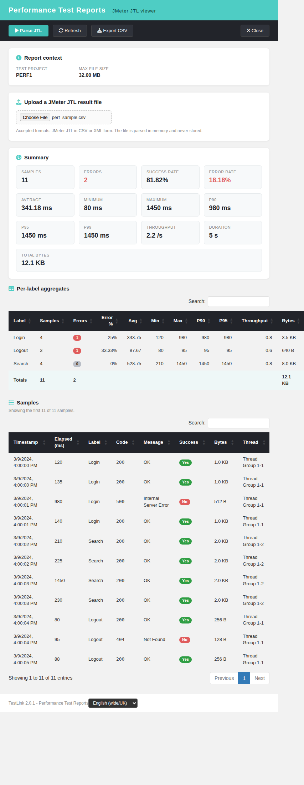

# Performance Test Reports / JMeter JTL Viewer — Modernized (TestLink 2.0.1, Refs #1063)

Net-new **JMeter JTL viewer + performance report** for TestLink, added to the
Reports menu (next to *Release Quality Gates*). TestLink 1.9.20 shipped no
JMeter/JTL viewer and the schema has no performance/automation result tables, so
this is a 2.0.1 enhancement rather than a legacy migration. The slice is
deliberately **stateless**: the caller uploads a JTL result log, the BFF parses
it on the fly and answers a report — nothing is persisted.

## Why this screen

Issue #1063 asks for a way to inspect an Apache JMeter result log (`.jtl`, CSV or
XML form) inside TestLink and turn it into a readable performance report —
summary metrics, per-label aggregates and a raw-sample table — instead of opening
the log in a spreadsheet.

## Modern stack

| Layer | File |
|---|---|
| Screen | `gui/templates/results/perfReports.html` (Dashio standalone HTML/JS/CSS) |
| BFF | `api/perfreports/index.php` (`GET\|HEAD ?action=init`, `POST ?action=parse`) |
| Wiring | `cfg/reports.cfg.php` `performance_reports` + `api/aside/index.php` `link_report_performance_reports` + `$actions->perfReports` in `lib/functions/common.php` |
| i18n | `perf.*` (74 keys) + `footers.perfReports` in **all 10** client bundles; `$TLS_link_report_performance_reports` in **all 19** server locales |

## BFF contract

| Method / route | Purpose | Notes |
|---|---|---|
| `GET\|HEAD ?action=init[&tproject_id=N]` | report context + limits | returns `context{tproject_id,tproject_name}` and `limits{max_file_bytes,max_samples,max_sample_rows}` |
| `POST ?action=parse` multipart `jtlFile=<file>[&tproject_id=N]` | parse a JTL | returns `{format,context,summary,labels[],samples[],samples_total,samples_shown,labels_total,truncated,empty}` |

Error contract: `400 invalid_request`, `401 not_authenticated`,
`403 no_right`, `404 tproject_not_found`, `405 method_not_allowed`,
`413 file_too_large`, `422 empty_file` / `unparsable_file`.

Caps: `PERF_MAX_FILE_BYTES` = 32 MB, `PERF_MAX_SAMPLES` = 300 000 (sets
`truncated`), `PERF_MAX_SAMPLE_ROWS` = 200 (raw table).

## Report content

- **Summary strip** — samples, errors, success rate, error rate, average, min,
  max, P90, P95, P99, throughput (per second), duration, total bytes.
- **Per-label aggregates** — a sortable DataTable: label, samples, errors, error
  %, avg, min, max, P90, P95, throughput, bytes, with a bold **Totals** row.
  Labels are ordered worst-first (most errors, then slowest average).
- **Samples** — a capped, sortable DataTable of the first
  `max_sample_rows` rows: timestamp, elapsed (ms), label, response code,
  response message, success, bytes, thread.
- **Export CSV** — the per-label table (UTF-8 BOM, `;`-separated, with a
  spreadsheet formula-injection guard).

## Interactions

- **Choose File + Parse JTL** — uploads the selected `.jtl`/`.csv`/`.xml` and
  renders the report; a *Choose a JTL file first* toast when nothing is selected.
- **Refresh** — re-runs `init` (reloads context/limits and clears the view).
- **Export CSV** — downloads the per-label aggregates.
- **Close** — closes the window (same idiom as the sibling result screens).
- **Locale switcher** — the standard `TLi18n` switcher; the whole page follows
  the selected bundle (English + Romanian + German + Spanish + French + Italian +
  Portuguese + Russian translated, Japanese/Chinese fall back to English).
- **State cards** — every BFF error code maps to a friendly title/body card,
  with the raw server message shown as an escaped detail. On error the context +
  upload panels stay visible so the user can pick another file immediately.

## Parsing

- **CSV** — header-driven (column order and extra columns do not matter); a
  missing `success` column falls back to the response code (4xx/5xx = error);
  a UTF-8 BOM on the header is stripped; blank lines are skipped; RFC-4180 quoting.
- **XML** — Apache JMeter's XML result log, read with the streaming `XMLReader`
  (`sample`/`httpSample` elements, `t`/`lb`/`rc`/`rm`/`s`/`ts`/`by`/`tn`
  attributes). A well-formed but sample-less `<testResults/>` answers
  `{empty:true}`, matching the header-only CSV path.

## Hardening

- Session auth (401 anonymous) + `bffSameOriginGuard()` + `bffEnforceSession()`.
- `testplan_metrics` on the **addressed** project; a missing/foreign/unknown
  project fails closed.
- `XMLReader` + `LIBXML_NONET` — no XXE, no external entities, no network fetch.
- `json_encode(..., JSON_INVALID_UTF8_SUBSTITUTE)` — a non-UTF-8 byte in a JTL
  label/response message cannot blank the response.
- `$_FILES` shape-checked against the `jtlFile[]` array shape; explicit
  `$_GET`/`$_POST` reads (not `$_REQUEST`); `Cache-Control: no-store`.
- Every BFF string is escaped client-side before it reaches the DOM.
