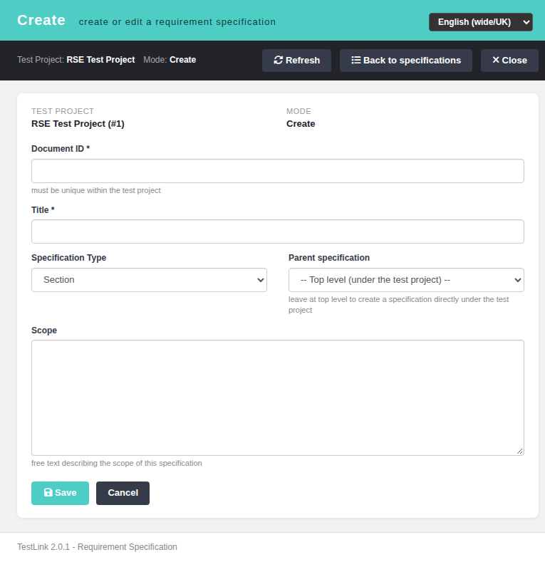
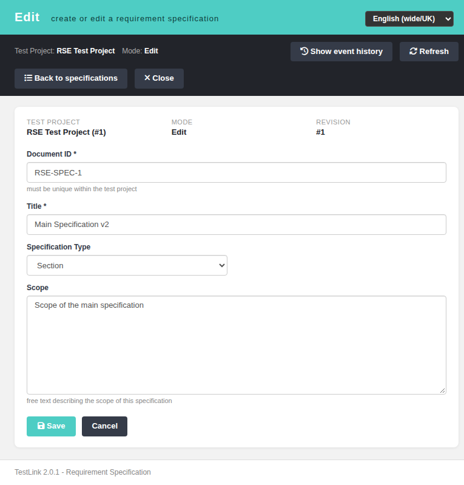
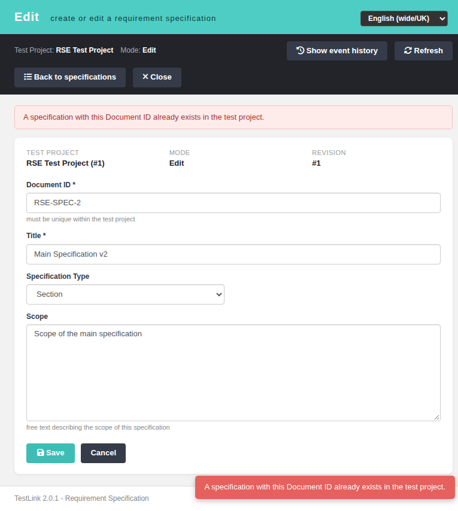

# Requirement Specification Create/Edit (modernized)

TestLink 2.0.1 — Requirements area, screen `reqSpecEdit` (Refs #1985).

Full-screen Dashio editor for creating a requirement specification and editing its
metadata. It replaces the render path of the standalone legacy controller
`lib/requirements/reqSpecEdit.php` (`doAction=create|createChild|edit`, 522 lines)
and its Smarty template `gui/templates/dashio/requirements/reqSpecEdit.tpl`.

## Legacy behavior preserved

- **Document ID** (required, unique within the test project).
- **Title** (required).
- **Type**: Section, User Requirements Specification, System Requirements Specification.
- **Scope** free text.
- **Requirement count** (only when `req_cfg->external_req_management` is enabled).
- **Nested creation** (only when `req_cfg->child_requirements_mgmt` is enabled):
  choose the parent specification, or leave "Top level" to put the new
  specification directly under the test project (`createChild`).
- **Edit mode**: the latest revision's document id, title, type, scope and count,
  the revision number, and the event-history shortcut (`req_specs`).
- Rights identical to the legacy `checkRights()` (`rightsAnd`):
  `mgt_view_req` **and** `mgt_modify_req` on the addressed test project.

## Modern screen

`gui/templates/requirements/reqSpecEdit.html`

- Teal Dashio header with the `TLi18n` locale switcher.
- Toolbar: event history (edit only), refresh, back to the specification manager,
  close.
- Context strip (test project, mode, revision) and a card with the form.
- State cards for loading, no right, not found, invalid request and server error.
- Success flash + toast; duplicate document id produces a localized error flash.

## BFF API

`api/reqspecedit/index.php` — plain PHP, session auth, JSON in/out, no Smarty.

| Method | Query | Purpose |
| --- | --- | --- |
| `GET`/`HEAD` | `?action=init&tproject_id=N[&spec_id=M]` | context, rights, settings, types, parent candidates and (edit) latest revision |
| `POST` | `?action=save` (JSON body) | create (`spec_id` 0/absent) or update (`spec_id > 0`) |

`POST` body: `{tproject_id, spec_id?, parent_id?, doc_id, title, type, total_req?, scope}`.

Security / contract:

- `bffSameOriginGuard()` on writes, `bffEnforceSession()` (401 `session_expired`),
  `Cache-Control: no-store`.
- Rights are checked on the **addressed** test project **before** it is resolved,
  so an unknown project and a real-but-unreadable project answer the same opaque
  403 (no existence oracle).
- Machine codes: 400 `invalid_request`/`missing_field`, 401
  `not_authenticated`/`session_expired`, 403 `no_right`, 404
  `tproject_not_found`/`spec_not_found`, 405 `method_not_allowed`, 409
  `duplicate_doc_id`.
- Writes delegate to `requirement_spec_mgr::create()` / `update()` (internal-link
  replacement, duplicate document-id check, revision handling unchanged). The
  parent of an existing specification is not re-posted here — the move/reorder
  endpoint owns node placement.

## Wiring

- `lib/functions/common.php`: `$actions->reqSpecEdit`.
- `gui/templates/requirements/projectReqSpecMgmt.html` launcher: the "New
  requirement specification" card now opens the full-screen editor (create mode).
- `gui/templates/requirements/reqSpecMgmt.html`: toolbar "Full-screen editor"
  button and a per-row full-screen action next to the inline edit modal.
- Legacy controller `lib/requirements/reqSpecEdit.php` is now a non-mutating
  **302 shim** for `create`, `createChild` and `edit` (POST included — the write
  belongs to the BFF). The original intent is forwarded as `legacy_intent`;
  `createChild` carries `parent_id`. Every other action of that controller
  (reorder, delete, freeze, create revision, attachments, copy requirements,
  bulk requirement monitor, copy) is untouched.

## i18n

`rse.*` (33 keys) plus `footers.reqSpecEdit` in all ten client bundles
(`de, en, es, fr, it, ja, pt, ro, ru, zh`). Gate:
`bash ai/verify_i18n_coverage.sh` → 9/9 PASS.

## Verification

Browser (admin, EN), fixtures: project "RSE Test Project" (#1).

- Create root specification, then create a nested child through the parent picker.
- Edit title/scope/type and save; revision badge and values reload correctly.
- Required-field validation (document id / title) client-side.
- Duplicate document id → 409 → localized "already exists" flash.
- Unknown `spec_id` → "Not found" state card with `spec_not_found`.
- Legacy `?doAction=create|createChild|edit` → 302 to the modern screen.
- Entry points from `reqSpecMgmt.html` and `projectReqSpecMgmt.html`.
- Console clean; Event Viewer: only INFO audit rows (no new Error/Warning).

Screenshots:

