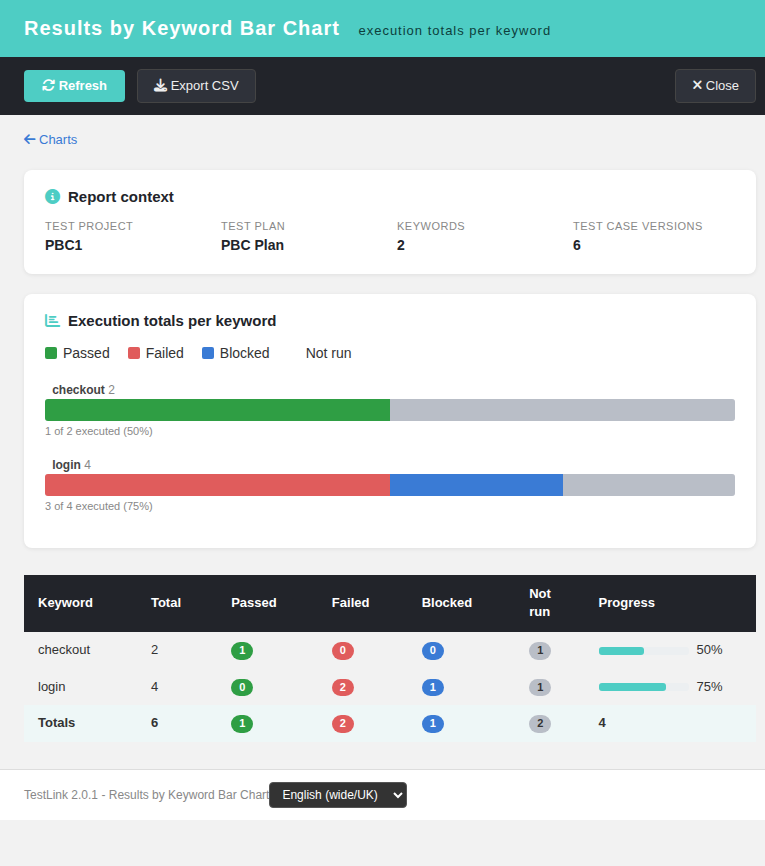

# Results by Keyword Bar Chart (Refs #1906)

Screen: `gui/templates/results/keywordBarChart.html` ·
BFF: `api/keywordbarchart/index.php` (`GET|HEAD ?action=init&tplan_id=N[&tproject_id=P]`) ·
Issue: #1906

## The last orphan Results chart endpoint

The ASIDE ledger (`docs/MODERNIZATION-STATUS.md`) showed **TODO = 0** — every screen
reachable from the ASIDE menu is already a modern Dashio page + REST BFF. An audit of
the remaining legacy `lib/**` controllers found one last class of live legacy renderers:
the pChart chart endpoints, which answer a PNG built by `charts.inc.php` +
`third_party/pchart`. Three of them — plus the priority bar chart, done in **#1845** —
were already modernized as standalone reports. **`keywordBarChart.php` was the sibling
left behind:**

| Evidence | Finding |
| --- | --- |
| ASIDE/Reports hub audit | `api/resultsnav/index.php` maps every report key to a modern `gui/templates/**/*.html`; no legacy `lib/results/` URL remains |
| `charts_data` payload (`api/reports`) | returns `overall`, `by_platform`, `by_keyword`, `by_suite` — the **pixels** of all four charts are covered by `charts.html` |
| What `charts.html` does NOT give | per-keyword DataTable, progress column, totals row, CSV export, rights-hardened BFF, standalone deep link |

So exactly like its **#1845** sibling (Priority Bar Chart), this is a *dedicated-screen*
modernization: the chart pixels already existed in a Chart.js section, but the legacy
endpoint's report — the exact numbers, the progress, the export — had no modern home and
no ownership-checked access.

## The legacy file and what it did

`lib/results/keywordBarChart.php` (1.9.20) never rendered a Smarty template. It required
`charts.inc.php` and answered a **PNG** of a stacked bar chart, one bar per keyword
actually linked to a plan test case, series pass / fail / blocked / not run, over all
builds + all platforms. Data came from `tlTestPlanMetrics::getStatusTotalsByKeywordForRender()`
(status totals keyed by keyword id; latest recorded result per test case wins). The legacy
chart drew the map as `array_flip($dataSet)` then `ksort()`, so keywords are ordered
**alphabetically by name** — the modern BFF reproduces that exact map and order. A plan
with no keyword-linked test cases answered *nothing* (issue #634 parity: `canDraw=false`),
which is the empty state of the screen.

By 2.0.1 the endpoint was a dead end: it required **two files that no longer exist**
(`third_party/charts/charts.php`, dropped with the chart library, and
`lib/functions/results.class.php`, split into per-area classes), so every request was an
uncaught `Error` → **HTTP 500 with an empty body**. No caller reached it, yet it was
still advertised as a report.

## Security gap closed

The legacy gate was `hasRight('testplan_metrics', ...)` evaluated through
`testlinkInitPage()` — a **global** right check that never tied the numbers to the plan
they belonged to, and the `tproject_id` came straight from `$_REQUEST`. The new BFF:

1. resolves the plan and derives the **owning** test project server-side;
2. checks `testplan_metrics` on that owning project **and** plan with
   `getAccess = true` (a right held only globally no longer reaches a private
   project, exactly like the accepted sibling `api/toplevelsuitesbarchart`; an
   unknown plan is a plain `404 tplan_not_found`, as in every sibling BFF);
3. treats `tproject_id` as a **client-side assertion** only — a stale deep link fails
   loudly (`project_mismatch`, 404) instead of silently reporting another project;
4. answers a documented JSON contract: `400 invalid_request`, `401 not_authenticated /
   session_expired`, `403 no_right`, `404 tplan_not_found / project_mismatch`,
   `405 method_not_allowed`, plus `nosniff` + `no-store`.

## The screen

`gui/templates/results/keywordBarChart.html` follows the **#1845/#1905** pattern: a Dashio
shell (teal header, dark toolbar), the report context strip (project, plan, keyword count,
version count), a "back to Charts" link, stacked horizontal bars drawn with **plain CSS**
(no chart library to ship), and a DataTable with the exact numbers behind every bar plus
a Totals row and a Progress (executed / total) column. Buttons: **Refresh**, **Export
CSV** (RFC 4180 quoting + UTF-8 BOM), **Close**. A footer locale switcher drives `TLi18n`;
every label is a bundle key (`kwbc.*`, `footers.keywordBarChart`,
`charts.openKeywordBarChart`) in all ten locales.

Entry points:
- `gui/templates/results/charts.html` — new *Open Results by Keyword Bar Chart* entry link
  in the *Results by Keyword* section (beside the #1845/#1905 links), wired to the active
  plan;
- `lib/functions/common.php` — `$actions->keywordBarChart` registered inside the
  `tplan_id` guard;
- the legacy endpoint `lib/results/keywordBarChart.php` is now a session-guarded
  **302 shim** to the modern screen (document navigation → redirect; XHR/`` caller →
  `405 modern_endpoint_only`, because the legacy answer was a PNG and a 302 would render
  broken pixels; missing `tplan_id` → 400; anonymous → login redirect preserving the
  destination).

## Testing

One fresh-DB end-to-end suite was appended to `tmp/TLU_Test_Cases.md`
(`## Task — Issue #1906`). 17 steps, all PASS: full 2-keyword chart render (checkout
1 of 2 = 50%, login 3 of 4 = 75%, totals 6 / 1 / 2 / 1 / 2, progress 4), the latest-wins
rule, empty-plan state, CSV export, **Română** locale, `no_right` denial as a restricted
(role 3) user, the BFF contract matrix (200/401/403/404/405), the shim matrix
(302/405/400), the charts.html entry link, and the i18n coverage gate. The `events`
table shows no unexpected Error/Warning rows (the single ERROR is the BFF's own intended
`no_right` audit denial exercised by the suite, exactly as the sibling BFFs log).
