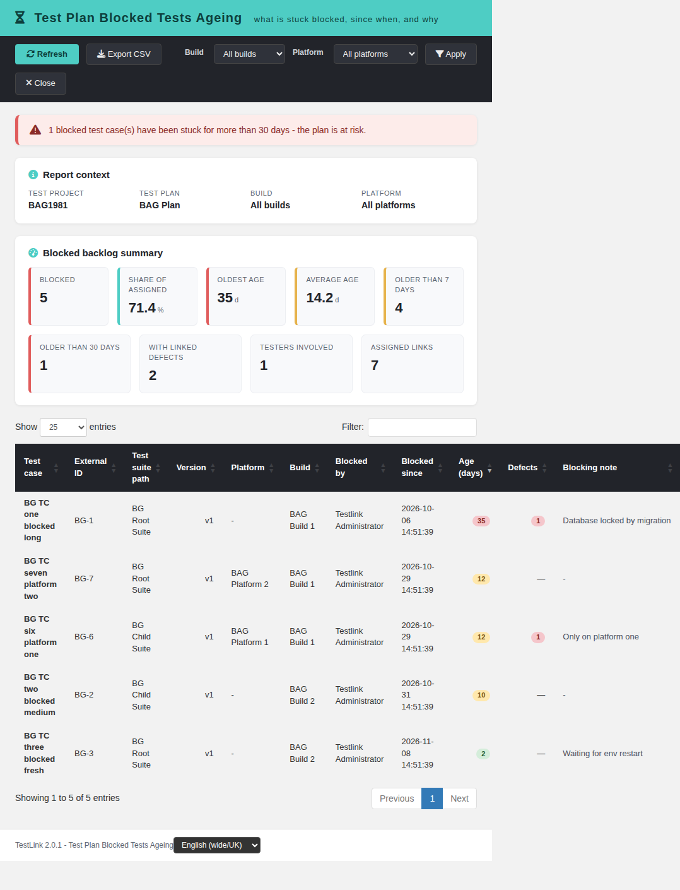
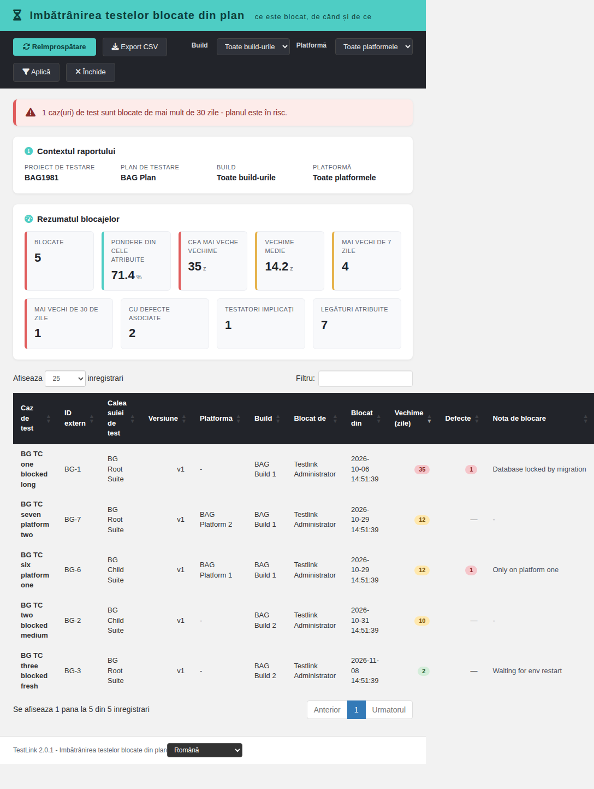
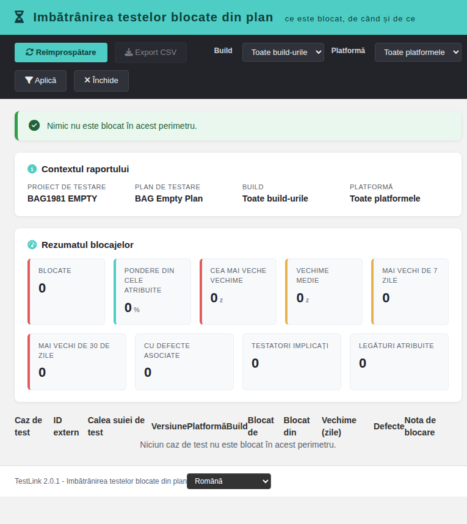

# Test Plan Blocked Tests Ageing (modernized)

Tracking issue: **#1981** (net-new report; parent metric: #1073, Metrics &
Trends). Bug **#1982** (E_WARNING on an execution-less scope) found by the
close-out Event Viewer pass and fixed in `4dbb4f897`.

## What it is

A net-new TestLink 2.0.1 report under **Reports**. TestLink 1.9.20 can list
the test cases whose CURRENT status is blocked (*Results by Status*), but it
never shows the **ageing** dimension of the blocked backlog: how long each
test has been stuck blocked, in which build/platform, with the blocking note
and the linked defects, and which blocked items are old enough to threaten
the plan. Nothing tracked blocked work over time.

The report lists every assigned test case whose latest execution is blocked,
ages it in whole days from the blocking execution, and flags the plan when
blocked items grow old. It is read-only.

## Screen

`gui/templates/results/blockedAgeing.html`

- Dashio teal header, dark toolbar (Refresh, Export CSV, Build, Platform,
  Apply, Close).
- Report-context panel (test project, test plan, selected build/platform).
- Verdict banner: `at_risk` (any blocked item older than 30 days), `watch`
  (older than 7 days), `fresh` (blocked but young) or `clear` (nothing stuck).
- 9 KPI cards: blocked links, share of assigned links, oldest age, average
  age, older than 7 days, older than 30 days, with linked defects, testers
  involved, assigned links.
- 11-column DataTable, oldest first: test case, external id, suite path,
  version, platform, build, blocked by, blocked since, age (days), defects,
  blocking note. Searchable, sortable, page-length control.
- Build and platform re-scoping (the platform filter also narrows the
  universe); a case that was blocked on one build but re-executed on a newer
  one is NOT stuck anymore — narrowing to the old build brings it back.
- CSV export `blocked-ageing-<plan>.csv` (UTF-8 BOM, `;` separator,
  spreadsheet-formula neutralisation), disabled on an error state.
- Localized state cards for 401 / 403 / 404 / 405, `project_mismatch`, unknown
  plan and empty scope (`Nothing is blocked in this scope`).
- Locale switcher (EN/RO verified) with every label in `bage.*` keys.

## BFF

`api/blockedageing/index.php` — plain PHP, session auth,
`bffSameOriginGuard`, `bffEnforceSession`, JSON I/O, `Cache-Control: no-store`.

| Action | Method | Parameters |
| --- | --- | --- |
| `init` | `GET\|HEAD` | `tplan_id`, optional `tproject_id` |
| `report` | `GET\|HEAD` | `tplan_id`, optional `tproject_id`, `build_id`, `platform_id` |

Rights: `testplan_metrics` on the **owning** test project of the plan
(`getAccess = true`). The client-supplied `tproject_id` is only an assertion
and can never widen the query. The build/platform ids must belong to that
project.

Error contract: `not_authenticated` (401), `no_right` (403),
`tplan_not_found` / `project_mismatch` (404), `invalid_request` (400),
`method_not_allowed` (405).

## Semantics

- The plan is resolved first (`testplans.id = tplan_id`); every query uses the
  owning `testproject_id` from the database.
- The universe is the set of `testplan_tcversions` links of the addressed plan
  (one assigned tcversion per platform link; `platform_id = 0` means "any
  platform" and matches every execution platform).
- The CURRENT result of a link is the LATEST execution (`execution_ts`, `id`)
  for the same (tcversion, platform) inside the plan and the selected
  build/platform scope.
- A row appears in the report when that latest execution is BLOCKED
  (`status = 'b'`). A test that was blocked once and later re-executed with
  any other status is NOT listed — it is no longer stuck (recovered).
- AGE is measured in whole days from the blocking execution timestamp to
  `NOW()` on the DB server clock; average age is over the stuck rows only.
- The linked-defect count of a row counts the `execution_bugs` rows attached
  to the blocking execution (step-level links included).
- `total_blocked_executions` counts every blocked execution in scope (context
  KPI), not only the latest; the loop tolerates a NULL recordset (zero
  executions in scope, #1982).
- Verdict: `at_risk` when any stuck row is older than 30 days, `watch` when
  any is older than 7 days, `fresh` when everything blocked is younger,
  `clear` when nothing is stuck.

## Integration

- `cfg/reports.cfg.php` registers `blocked_ageing` with
  `link_report_blocked_ageing`.
- `api/aside/index.php` maps it to the modern screen with the plan context;
  `api/resultsnav/index.php` and `$actions->blockedAgeing` provide the other
  entry points.
- `$TLS_link_report_blocked_ageing` is present in all 19 server locales.
- 56 `bage.*` keys plus `footers.blockedAgeing` are present in all 10 client
  bundles; `bash ai/verify_i18n_coverage.sh` passes 9/9.

## Suite

`Suite #1981` in `tmp/TLU_Test_Cases.md` — **14/14 PASS** (init, default
scope KPIs and ordering, build and platform re-scoping with recovery
re-inclusion, empty plan, 404 / 403, CSV, EN→RO, DataTables controls, Reports
menu wiring, console clean) plus the machine harness
`tmp/verify_1981.php` — **32/32 PASS** (semantics, recovered / never-run
exclusion, error contract 400/401/403/404/405, CSRF, session). Fixture:
`tmp/fixtures_1981.php` (project `BAG1981`, 2 plans, 2 builds, 2 platforms,
7 cases, 7 executions, one recovered on build 2, one never run, no-right
user `bage1981norights`).
