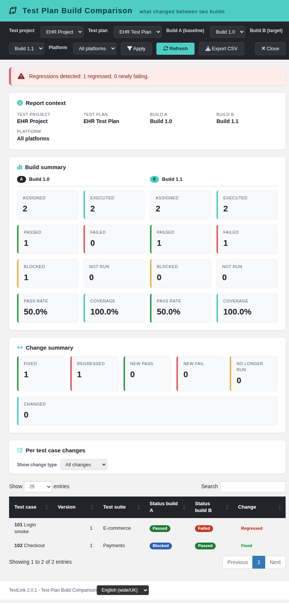
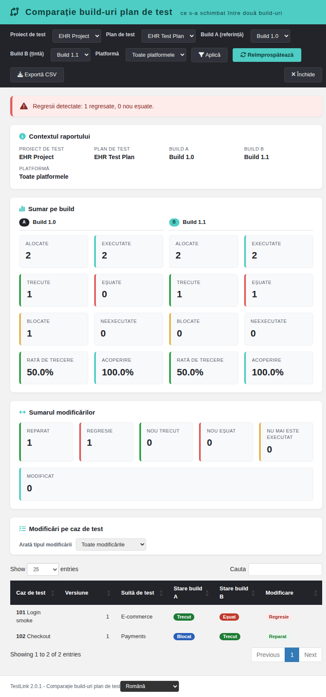

# Test Plan Build Comparison (Modernized) — Issue #1962

The modern Dashio page **`gui/templates/results/buildComparison.html`**, backed by the
BFF **`api/buildcomparison/index.php`**, is a **net-new 2.0.1 report**: TestLink
1.9.20 shows only the current status of a plan and no report answers "what changed
for the individual test-case versions between build A and build B?" The
`planComparison` report compares two plans; this screen compares the **same** test
plan across **two builds** and shows per test-case version how its execution
status moved (regressed / fixed / new pass / new fail / unchanged).

## Layout
- **Header** (teal Dashio) with the report title and the locale switcher in the footer.
- **Toolbar**: Test project, Test plan, **Build A (baseline)**, **Build B (target)**,
  **Platform**, Apply, Refresh, **Export CSV**, Close.
- **Regressions banner**: warns when regressions or newly failing cases are detected.
- **Report context** card: test project, test plan, build A, build B, platform.
- **Build summary** cards (A and B): assigned, executed, passed, failed, blocked,
  not run, pass rate, coverage.
- **Change summary** cards: Fixed, Regressed, New pass, New fail, No longer run, Changed.
- **Per test case changes** DataTable with a **change type** filter and CSV export.

## Semantics (computed by the BFF, the client only renders it)
- The universe is **test-case versions assigned to the test plan**
  (`testplan_tcversions`) in the selected project/plan and (when filtered) on the
  selected platform.
- **Latest execution wins** per (tcversion_id, build_id, [platform_id]) using
  `MAX(executions.id)`.
- `assigned` = linked versions; `executed` = versions with a known final status;
  `not_run` = assigned - executed.
- `pass_rate` = passed / executed; `coverage` = executed / assigned.
- **Change classification** compares status_a vs status_b: `regressed`
  (passed -> failed), `fixed` (failed/blocked -> passed), `new_pass` (not run -> passed),
  `new_fail` (not run -> failed), `revived` (executed in A but no execution in B?),
  else unchanged categories (`same_passed` / `same_failed` / `same_blocked` /
  `same_not_run`) or `changed` in other transitions.

## Filters
- `tproject_id`, `tplan_id` — scope.
- `build_a`, `build_b` — the two builds to compare (both must belong to the plan/project).
- `platform_id` — restricts assignments and executions to that platform.

## Data model (BFF `api/buildcomparison/index.php`)
- **Routes**: `GET|HEAD ?action=projects` (project picker), `?action=init&tproject_id=N`
  (plans + builds + platforms), `?action=report&tplan_id=N&tproject_id=P&build_a=B&build_b=C[&platform_id=PL]`.
- **Rights**: `testplan_metrics` on the owning project of the test plan.
- **Error contract**: `400 invalid_request`, `401 not_authenticated|session_expired`,
  `403 no_right`, `404 tplan_not_found|project_mismatch`, `405 method_not_allowed`,
  `500 server_error`.

## i18n
All labels come from `TLi18n` keys under `bcmp.*` and `footers.buildComparison` in all
10 client bundles; server menu entry uses `link_report_build_comparison` in all 19
locales.

## Screenshots

