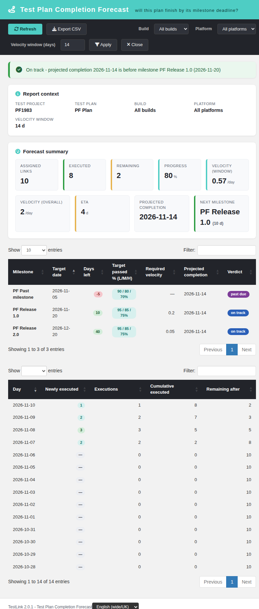
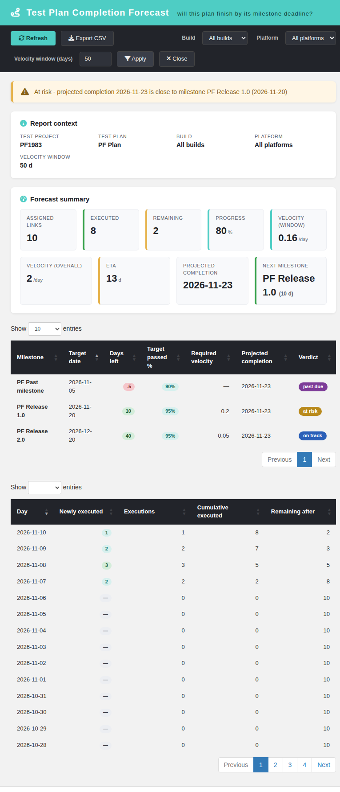
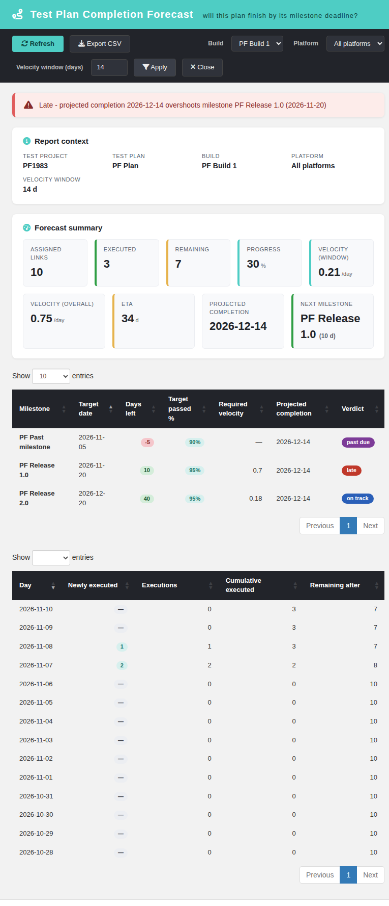
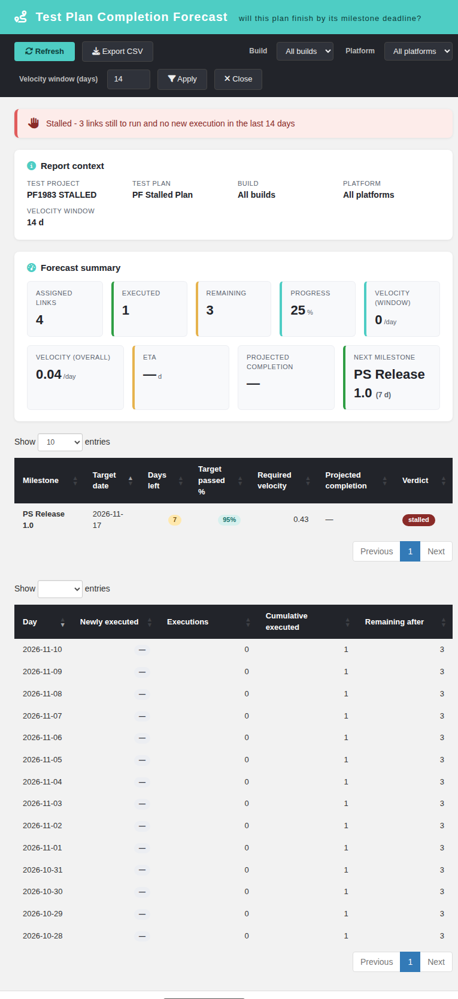

# Test Plan Completion Forecast (modernized)

Tracking issue: **#1983** (net-new report; sibling of #1980/#1981 in the
Test Plan reports vein).

## What it is

A net-new TestLink 2.0.1 report under **Reports**. TestLink 1.9.20/2.0.1 can
show what already happened — progress percentage, burn-down, results by
build — but it never answers the manager's closing question: **will this
plan finish by its milestone deadline?** The Completion Forecast computes
the execution velocity over a trailing window, projects the completion date
of the remaining work from it, and compares that projection against every
milestone of the plan. Read-only.

## Screen

`gui/templates/results/planForecast.html`

- Dashio teal header, dark toolbar (Refresh, Export CSV, Build, Platform,
  velocity window, Apply, Close).
- Report-context panel (test project, test plan, selected build/platform,
  velocity window in days).
- Verdict banner: `on_track` (ETA before the next milestone), `at_risk`
  (ETA within 7 days past it), `late` (further out), `stalled` (no new
  execution inside the window), `past_due`, `no_milestone`, `no_data`,
  `complete`.
- 9 KPI cards: assigned links, executed, remaining, progress %, window
  velocity, overall velocity, ETA days, projected completion date, next
  milestone.
- Milestone-projection DataTable (searchable): milestone, target date, days
  left, target passed % (low/medium/high `a`/`b`/`c` columns of the legacy
  milestone definition), required velocity, projected completion,
  per-milestone verdict.
- Daily activity DataTable (trailing window, newest first, searchable): day,
  newly executed (first executions), executions, cumulative executed,
  remaining after.
- Build and platform re-scoping; velocity window 1–90 days.
- CSV export `plan-forecast-<plan>.csv` (UTF-8 BOM, `;` separator,
  spreadsheet-formula neutralisation), disabled on error and empty plans; three
  sections: forecast summary, milestone projection and daily activity.
- Localized state cards for 401 / 403 / 404 / 405, `project_mismatch`,
  unknown plan; locale switcher (EN/RO verified), all labels in `pf.*` keys.

## BFF

`api/planforecast/index.php` — plain PHP, session auth,
`bffSameOriginGuard`, `bffEnforceSession`, JSON I/O,
`Cache-Control: no-store`, `JSON_INVALID_UTF8_SUBSTITUTE`.

| Action | Method | Parameters |
| --- | --- | --- |
| `init` | `GET\|HEAD` | `tplan_id`, optional `tproject_id` |
| `report` | `GET\|HEAD` | `tplan_id`, optional `tproject_id`, `build_id`, `platform_id`, `days` (1–90, default 14) |

Rights: `testplan_metrics` on the **owning** test project of the plan. The
client-supplied `tproject_id` is only an assertion and can never widen the
query. Build/platform ids must belong to that project.

Error contract: `not_authenticated` (401), `no_right` (403),
`tplan_not_found` / `project_mismatch` (404), `invalid_request` (400),
`method_not_allowed` (405).

## Semantics

- The plan is resolved first; every query uses the owning `testproject_id`.
- The universe is the `testplan_tcversions` links of the plan
  (`platform_id = 0` = "any platform", matching every execution platform).
- A link is EXECUTED when it has at least one execution inside the selected
  build/platform scope; remaining = assigned − executed.
- VELOCITY counts FIRST executions per day (a re-run never inflates it):
  window velocity = first-executions inside the trailing `days` window ÷
  window length; overall velocity = first-executions ever ÷ days since the
  first execution.
- ETA = today + ceil(remaining ÷ window velocity) calendar days. Verdict
  precedence: `no_data` (assigned 0) > `complete` (remaining 0) >
  `stalled` (window velocity 0) > milestone verdict.
- Milestone verdict: projected completion ≤ target date → `on_track`;
  ≤ target + 7 days → `at_risk`; later → `late`; target already past →
  `past_due`. Required velocity = remaining ÷ days left.
- The ETA divides by the UNROUNDED window velocity; the first-execution
  group rows are read in ascending day order so a platform-less link is
  stamped by its EARLIEST proving execution (code review fixes).
- `no_milestone` when the plan has no milestone with a target date ≥ today
  (banner still shows the ETA).

## Integration

- `cfg/reports.cfg.php` registers `plan_forecast` with
  `link_report_plan_forecast`.
- `api/aside/index.php` maps it to the modern screen with the plan context;
  `$actions->planForecast` provides the other entry point.
- `$TLS_link_report_plan_forecast` is present in all 19 server locales.
- 72 `pf.*` keys plus `footers.planForecast` are present in all 10 client
  bundles; `bash ai/verify_i18n_coverage.sh` passes 9/9.

## Suite

`Suite #1983` in `tmp/TLU_Test_Cases.md` — **14/14 PASS** (default scope
KPIs, milestone + activity tables, build/window re-scoping through the
on_track / at_risk / late verdict flip, stalled and empty plans,
no-milestone, CSV, EN→RO, 404 states, BFF machine checks, Reports menu
wiring, console clean). Fixture: `tmp/fixtures_1983.php` (projects
`PF1983` / `PF1983 STALLED` / `PF1983 EMPTY`).
