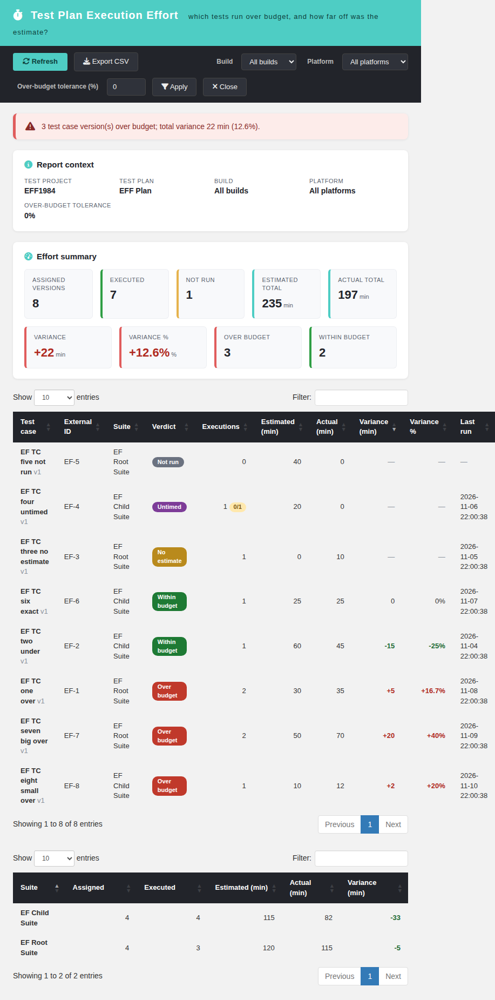
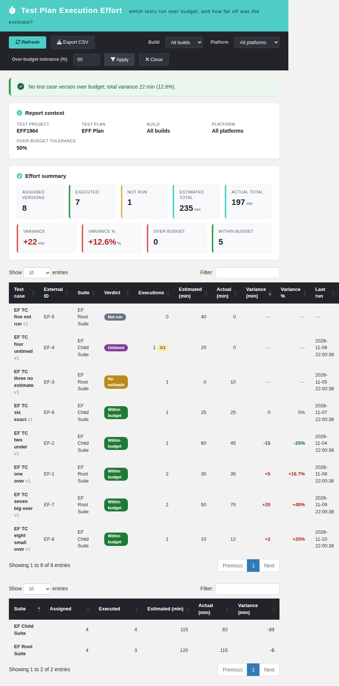
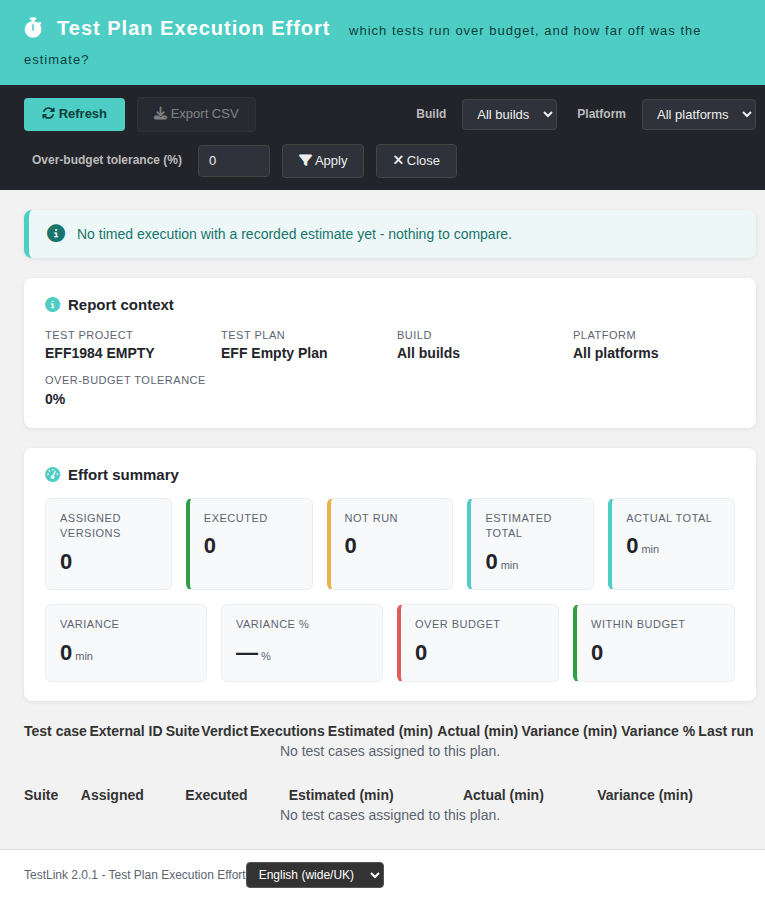
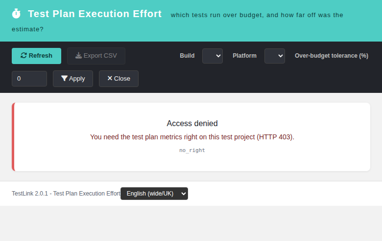

# Test Plan Execution Effort (modernized)

Tracking issue: **#1984** (legacy report `exec_effort`, brought to 2.0.1 with
full Dashio parity).

## What it is

The TestLink 1.9.20 **Estimated vs Actual Execution Effort** report, rewritten
for 2.0.1. It answers one question per assigned test-case version: **did the
execution take longer than the estimate, and by how much?** The report shows
the plan-wide effort summary, a worst-overrun-first per-version table, and a
per-suite breakdown. Read-only.

## Screen

`gui/templates/results/execEffort.html`

- Dashio teal header, dark toolbar (Refresh, Export CSV, Build, Platform,
  over-budget tolerance, Apply, Close).
- Report-context panel (test project, test plan, selected build/platform,
  active tolerance).
- Verdict banner: `over` (at least one version exceeds the tolerance),
  `within` (all timed versions inside it), `no_data` (nothing timed yet).
- 9 KPI cards: assigned versions, executed, not run, estimated total, actual
  total, variance (min), variance %, over budget, within budget.
- Per-version DataTable (searchable, worst overrun first): test case,
  external id, suite, verdict (`over` / `within` / `not_run` / `untimed` /
  `no_estimate`), executions, estimated min, actual min, variance min,
  variance %, last run.
- Per-suite DataTable (searchable): suite, assigned, executed, estimated,
  actual, variance.
- Build and platform re-scoping; over-budget tolerance 0–100 % re-judges the
  verdict without hiding the true variance.
- CSV export `execution-effort-<plan>.csv` (UTF-8 BOM, `;` separator,
  spreadsheet-formula neutralisation), disabled on error and empty plans;
  three sections: effort summary, per-version rows, per-suite breakdown.
- Localized state cards for 400 / 401 / 403 / 404 / 405 and
  `project_mismatch`; locale switcher (EN/RO verified), all labels in `eff.*`
  keys.

## BFF

`api/execeffort/index.php` — plain PHP, session auth,
`bffSameOriginGuard`, `bffEnforceSession`, JSON I/O,
`Cache-Control: no-store`, `JSON_INVALID_UTF8_SUBSTITUTE`.

| Action | Method | Parameters |
| --- | --- | --- |
| `init` | `GET\|HEAD` | `tplan_id`, optional `tproject_id` |
| `report` | `GET\|HEAD` | `tplan_id`, optional `tproject_id`, `build_id`, `platform_id`, `over_pct` (0–100, default 0) |

Rights: `testplan_metrics` on the **owning** test project of the plan. The
client-supplied `tproject_id` is only an assertion and can never widen the
query. Build/platform ids must belong to that project.

Error contract: `not_authenticated` (401), `no_right` (403),
`tplan_not_found` / `project_mismatch` (404), `invalid_request` (400),
`method_not_allowed` (405).

## Semantics

- The plan is resolved first; every query uses the owning `testproject_id`.
- The universe is the `testplan_tcversions` links of the plan
  (`platform_id = 0` = "any platform", matching every execution platform).
- A version is TIMED when it has at least one execution with a recorded
  `execution_duration`; the actual effort is the sum of those durations, the
  estimate is the version's `estimated_execution_duration` (0 = no estimate).
- Variance = actual − estimated. A version is `over` when
  `variance % > over_pct` (estimate 0 with actual > 0 counts as over), else
  `within`; `not_run` when the version has no execution in scope, `untimed`
  when executions exist but none recorded a duration, `no_estimate` when a
  duration exists but the estimate is 0.
- The plan-wide verdict is `over` when at least one version is over the
  tolerance, never merely because the total variance is positive (code review
  fix `d6c7d6a38`).
- A refused authorization is logged at **AUDIT**, not ERROR, so the Event
  Viewer close-out stays clean (same convention as the sibling report BFFs).

## Integration

- `cfg/reports.cfg.php` registers `exec_effort` with
  `link_report_exec_effort`.
- `api/aside/index.php` maps it to the modern screen with the plan context;
  `$actions->execEffort` provides the other entry point.
- `$TLS_link_report_exec_effort` is present in all 19 server locales.
- 66 `eff.*` keys plus `footers.execEffort` are present in all 10 client
  bundles; `bash ai/verify_i18n_coverage.sh` passes 9/9.

## Suite

`Suite #1984` in `tmp/TLU_Test_Cases.md` — **14/14 PASS** (default-scope
KPIs, per-version and per-suite tables, tolerance re-judging, build
re-scoping, empty plan, missing plan id, CSV, EN→RO, 403 no-right, BFF machine
contract, Reports menu wiring, Event Viewer, i18n gate). Fixture:
`tmp/fixtures_1984.php` (projects `EFF1984` / `EFF1984 EMPTY`, plans 3/4,
user `eff1984norights`).
