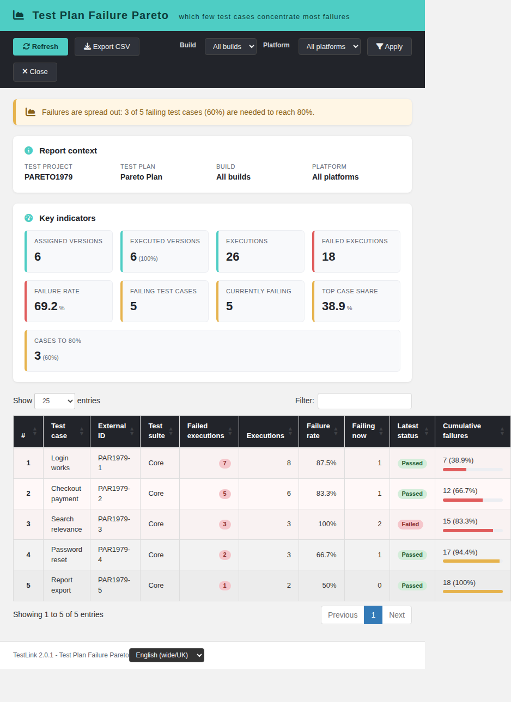
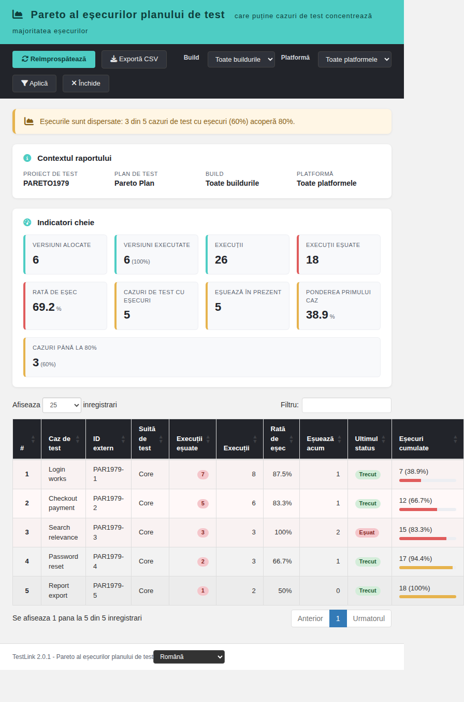
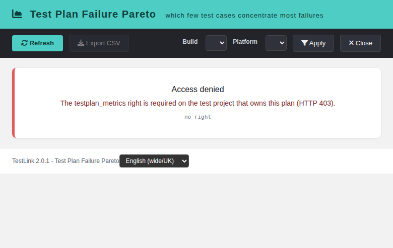

# Test Plan Failure Pareto (modernized)

Tracking issue: **#1979** (net-new report; parent metric: #1073, Metrics &
Trends).

## What it is

A net-new TestLink 2.0.1 report under **Reports**. TestLink 1.9.20 can report
execution status per build, suite, tester or keyword, but never answers
"**which few test cases concentrate most of the failures?**" — the Pareto
question that tells a lead where a stabilization effort will pay off first.

The report ranks the test-case versions assigned to a plan by their number of
failed executions, accumulates the failure share, and marks the smallest set of
cases that reaches 80% of all failures. It is read-only.

## Screen

`gui/templates/results/failurePareto.html`

- Dashio teal header, dark toolbar (Refresh, Export CSV, Build, Platform,
  Apply, Close).
- Report-context panel (test project, test plan, selected build/platform).
- Verdict banner: `clean` (no failures), `concentrated` (the 80% set is at most
  20% of the failing cases, i.e. a real 80/20), or `diffuse` (failures are
  spread out).
- 9 KPI cards: assigned versions, executed versions (+ coverage), executions,
  failed executions, failure rate, failing test cases, currently failing
  units, top-case share, cases to 80%.
- 10-column DataTable: rank, test case, external id, suite path, failed
  executions, total executions, failure rate, currently failing units, latest
  status, cumulative failures with a share bar. Rows in the 80% set are tinted.
- Build and platform re-scoping (the platform filter also narrows the universe).
- CSV export (UTF-8 BOM, `;` separator, spreadsheet-formula neutralisation).
- Localized state cards for 401 / 403 / 404 / 405, `project_mismatch`, unknown
  plan and empty scope.
- Locale switcher (EN/RO verified) with every label in `fp.*` keys.

## BFF

`api/failurepareto/index.php` — plain PHP, session auth,
`bffSameOriginGuard`, `bffEnforceSession`, JSON I/O, `Cache-Control: no-store`.

| Action | Method | Parameters |
| --- | --- | --- |
| `init` | `GET\|HEAD` | `tplan_id`, optional `tproject_id` |
| `report` | `GET\|HEAD` | `tplan_id`, optional `tproject_id`, `build_id`, `platform_id` |

Rights: `testplan_metrics` on the **owning** test project of the plan
(`getAccess = true`). The client-supplied `tproject_id` is only an assertion and
can never widen the query. The build/platform ids must belong to that project.

Error contract: `not_authenticated` (401), `no_right` (403),
`tplan_not_found` / `project_mismatch` (404), `invalid_request` (400),
`method_not_allowed` (405).

## Semantics

- The plan is resolved first (`testplans.id = tplan_id`); every query uses the
  owning `testproject_id` from the database.
- The universe is the set of distinct test-case versions linked to the plan
  (`testplan_tcversions`), optionally narrowed to one platform. A version
  linked on two platforms is still one row (the report measures versions).
- **Failed executions** counts every execution of those versions with status
  `f` inside the scope (plan + optional build + optional platform). `blocked`
  (`b`) is reported in the summary but never counted as a failure.
- **Currently failing units** counts the latest execution per
  `(tcversion, platform)` whose status is `f` — a case that failed earlier but
  passed last is not "currently failing". The latest status column shows the
  latest execution per version.
- Rows are ranked by failed executions desc, then currently failing units desc,
  then test-case name. Cumulative failures are absolute and as a percentage of
  all failed executions in scope; `in_top80` marks the smallest prefix that
  reaches 80%.
- `failure_rate_pct = failed / total executions of the version`. The KPI
  failure rate is `failed / all executions in scope`.
- Verdict: `clean` when there is no failed execution; `concentrated` when the
  80% set is at most 20% of the failing test cases; `diffuse` otherwise.
- `assigned_versions` / `executed_versions` describe the plan universe, so a
  version with no executions is still counted and lowers execution coverage.

## Integration

- `cfg/reports.cfg.php` registers `failure_pareto` with
  `link_report_failure_pareto`.
- `api/aside/index.php` maps it to the modern screen with the plan context;
  `api/resultsnav/index.php` and `$actions->failurePareto` provide the other
  entry points.
- `$TLS_link_report_failure_pareto` is present in all 19 server locales.
- 58 `fp.*` keys plus `footers.failurePareto` are present in all 10 client
  bundles; `bash ai/verify_i18n_coverage.sh` passes 9/9.

## Suite

`Suite #1979` in `tmp/TLU_Test_Cases.md` — **18/18 PASS** (init, default
ranking/cumulative, build / platform / combined filters, clean and concentrated
verdicts, cross-project and unknown-plan 404, 400 / 401 / 403, CSV, EN→RO,
Reports/ASIDE integration, console clean). Fixture: `tmp/fixtures_1979.sql`.
