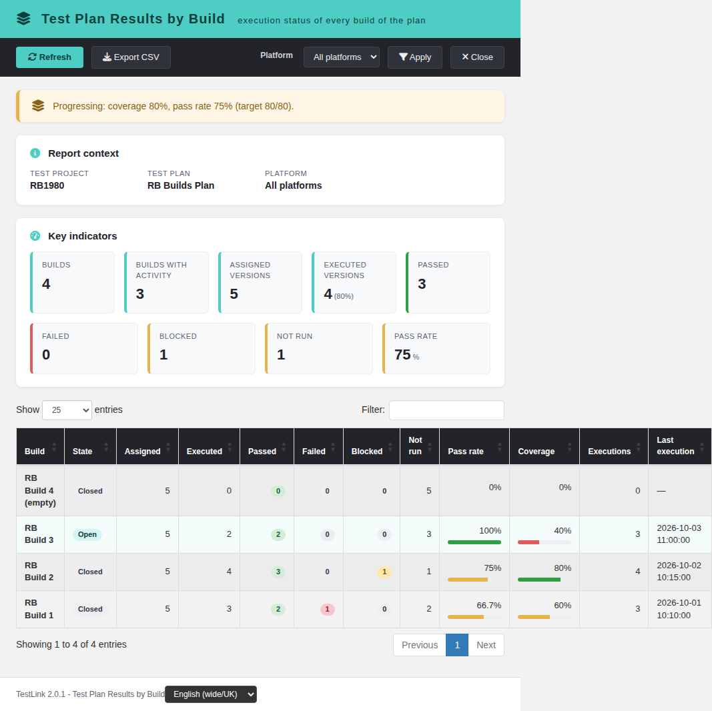
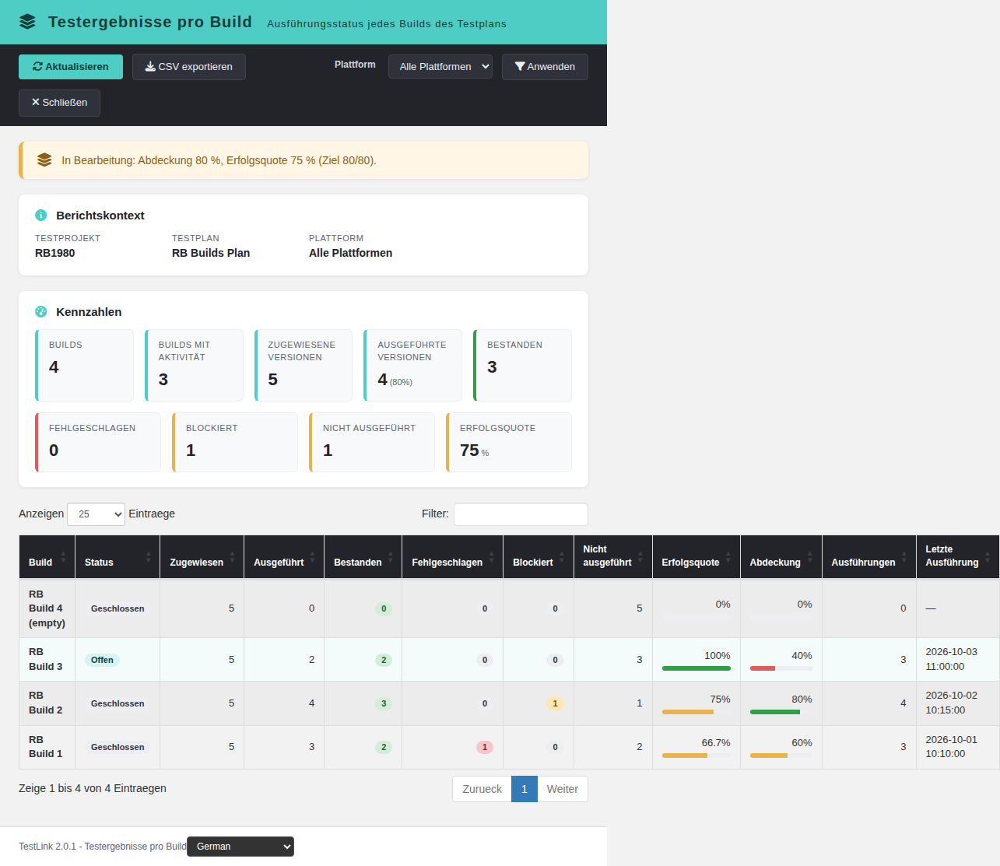
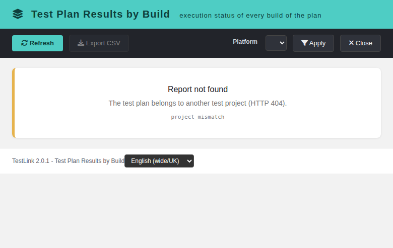

# Test Plan Results by Build (modernized)

Tracking issue: **#1980** (net-new report; parent area: Reports).

## What it is

A read-only TestLink 2.0.1 report under **Reports** that shows, for one test
plan, how far every build got: how many of the plan's assigned test-case
versions were executed in that build, their latest status inside that build,
the pass rate, the coverage and the number of execution events.

The build timeline is the question a release lead asks before promoting the
next build — "did this build regress, and how much of the plan has it
actually exercised?" — and 1.9.20 answers it only per test case or per fixed
pair of builds. This screen puts every build of the plan side by side and
adds a plan-wide snapshot that uses the latest result of each version across
all builds.

## Screen

`gui/templates/results/resultsByBuild.html`

- Dashio teal header, dark toolbar (Refresh, Export CSV, Platform, Apply,
  Close).
- Report-context panel (test project, test plan, selected platform).
- Verdict banner over the plan-wide snapshot: `ready` (coverage and pass rate
  at least 80%), `at_risk` (coverage or pass rate below 50%), `watch` (the
  normal in-progress case), `empty` (the plan has no assigned version).
- 9 KPI cards: builds, builds with activity, assigned versions, executed
  versions (+ coverage), passed, failed, blocked, not run, pass rate.
- 12-column DataTable, newest build first: build, state (`Open` / `Closed`
  from `builds.is_open`), assigned, executed, passed, failed, blocked, not
  run, pass rate (with bar), coverage (with bar), execution events, last
  execution. Every build of the project is listed — a build without any
  execution shows zeros instead of disappearing — and open builds are tinted.
- Platform re-scoping (the platform filter also narrows the assigned
  versions, as on every other results report).
- CSV export (UTF-8 BOM, `;` separator, spreadsheet-formula neutralisation).
- Localized state cards for 401 / 403 / 404 / 405, `project_mismatch`,
  unknown plan and `invalid_request`.
- Locale switcher; every label comes from the `rbb.*` keys (55 keys × 10
  bundles) plus `footers.resultsByBuild`.

## BFF

`api/resultsbybuild/index.php` — plain PHP, session auth,
`bffSameOriginGuard`, `bffEnforceSession`, JSON I/O, `Cache-Control: no-store`.

| Action | Method | Parameters |
| --- | --- | --- |
| `init` | `GET\|HEAD` | `tplan_id`, optional `tproject_id`, `platform_id` |
| `report` | `GET\|HEAD` | `tplan_id`, optional `tproject_id`, `platform_id` |

Rights: `testplan_metrics` on the **owning** test project of the plan
(`getAccess = true`). The client-supplied `tproject_id` is only an assertion
and can never widen the query; a non-numeric `platform_id` is rejected before
any lookup and a platform that does not belong to the project answers 400.

Error contract: `not_authenticated` (401), `no_right` (403),
`tplan_not_found` / `project_mismatch` (404), `invalid_request` (400),
`method_not_allowed` (405).

## Semantics

- The plan is resolved first (`testplans.id = tplan_id`); every query uses the
  owning `testproject_id` from the database.
- The universe is the set of distinct test-case versions linked to the plan
  (`testplan_tcversions`), optionally narrowed to one platform.
- **Per-build snapshot**: one pass over the plan's executions in canonical
  order (`executions.id ASC`), keeping the last status seen for every
  `(build, version)`. A retest in the same build replaces the earlier result
  but still counts as an execution event.
- **Plan snapshot (summary)**: the last status seen for every version across
  all builds — the current state of the plan, no matter which build produced
  it.
- Only `p` / `f` / `b` count as executed; `not_run = assigned − executed`.
  `coverage_pct = executed / assigned`, `pass_rate_pct = passed / executed`.
- `total_executions` counts execution events attached to a real build
  (`build_id > 0`), so a plan-wide counter and the per-build events always
  agree.
- Rows are sorted by build id descending (creation order = build order). A
  build referenced by an execution but no longer present in the project is
  appended with a synthetic `#id` name so history never disappears.

## Verification

Fixture `tmp/fixtures_1980.php`: project `RB1980` (id 1) with the plan
`RB Builds Plan` (id 3), builds 1–3 carrying 10 executions (including a retest
inside build 3) plus the empty build 4, an empty plan `RB Empty Plan` (id 4),
and the right-less user `nop1980`.

- Default scope (plan 3): 4 builds, 3 with activity, 5 assigned, 4 executed
  (80%), 3 passed, 0 failed, 1 blocked, 1 not run, 10 execution events, pass
  rate 75%, verdict `watch`.
- Per build: build 3 (open) 2 executed / 3 events / 40%, build 2 4 / 4 / 80%,
  build 1 3 / 3 / 60% with 1 failure, build 4 (empty) all zeros.
- Empty plan 4: verdict `empty`, "no build yet" banner, CSV disabled.
- `tproject_id=2` → 404 `project_mismatch`; `tplan_id=999` → 404; missing
  `tplan_id`, unknown `action` and non-numeric / foreign `platform_id` → 400;
  unauthenticated → 401; `nop1980` → 403; POST without an Origin proof → 403;
  HEAD → 200.
- Browser: EN + DE render (no raw keys), filtered search shows the localized
  no-match row, state badges `Open`/`Closed`, 404 state card, Close returns to
  `/index.php`, console clean.
- Suite #1980 = 18/18 (`tmp/TLU_Test_Cases.md`); i18n gate 9/9.

## Wiring

- Reports launcher: `cfg/reports.cfg.php` (`results_by_build`),
  `api/aside/index.php` (`link_report_results_by_build`) and
  `api/resultsnav/index.php` (`results_by_build`).
- ASIDE / `$actions->resultsByBuild` in `lib/functions/common.php`.
- Server menu label `$TLS_link_report_results_by_build` in all 19
  `locale/*/strings.txt`.
