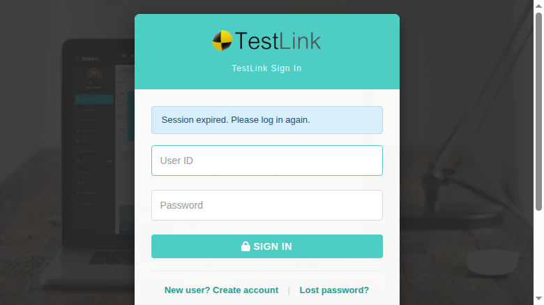
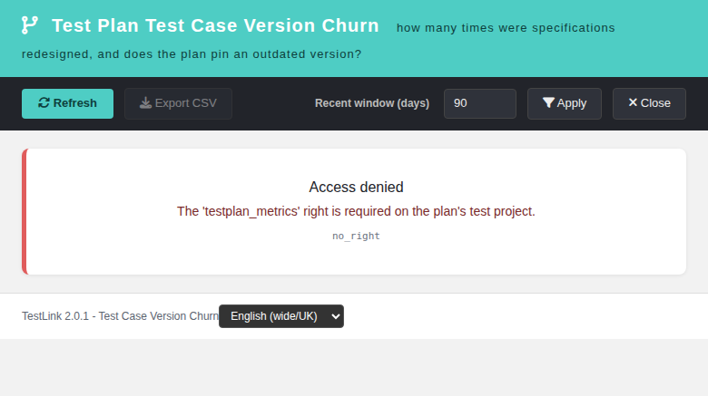

# Test Plan Test Case Version Churn (Rework) (modernized)

Tracking issue: **#1986** (net-new 2.0.1 report; TestLink 1.9.20/2.0.1 already
kept every design revision of a test case but shipped no screen that reported
how much the plan's specifications were rewritten).

## What it is

TestLink keeps **every** revision of a test case in `tcversions` and pins one
or more of them on the test plan through `testplan_tcversions`. A test case
redesigned eight times before the plan pinned it looks exactly like a clean
one, and a plan that keeps pinning an **older** design than the newest one is
invisible. This read-only report exposes that churn/rework signal per assigned
test case, with a plan-wide verdict and a per-suite breakdown.

## Screen

`gui/templates/results/versionChurn.html`

- Dashio teal header, dark toolbar (Refresh, Export CSV, window selector,
  Apply, Close).
- Report-context panel (test project, test plan, active window in days).
- Verdict banner: `churning` (at least one churning case), `watch` (no
  churning case but at least one watch case), `stable` (everything stable),
  `no_data` (the plan has no assigned cases).
- 10 KPI cards: test cases, assigned versions, design versions, average
  versions per case, reworked cases, churning, watch, stable, versions
  created in the window, cases behind the newest design.
- Per-test-case DataTable (searchable, churn-first ordering): test case,
  external id, suite, assigned versions, newest version, versions, rework,
  in window, behind, last design change, last execution, verdict.
- Per-suite DataTable (searchable): suite, cases, versions, rework, average
  versions, churning.
- Trailing window selector (`1..3650` days, default `90`) re-judges the
  in-window counters and the verdict without hiding the design history.
- CSV export `version-churn-<plan>.csv` (UTF-8 BOM, `;` separator,
  spreadsheet-formula neutralisation), disabled on error and empty plans;
  three sections: summary KPIs, per-test-case rows, per-suite breakdown.
- Localized state cards for 400 / 401 / 403 / 404 / 405 and
  `project_mismatch`; locale switcher, all labels in `vchurn.*` keys.

## BFF

`api/versionchurn/index.php` — plain PHP, session auth,
`bffSameOriginGuard`, `bffEnforceSession`, JSON I/O,
`Cache-Control: no-store`, `JSON_INVALID_UTF8_SUBSTITUTE`.

| Action | Method | Parameters |
| --- | --- | --- |
| `init` | `GET\|HEAD` | `tplan_id`, optional `tproject_id` |
| `report` | `GET\|HEAD` | `tplan_id`, optional `tproject_id`, `window_days` (1–3650, default 90) |

Rights: `testplan_metrics` on the **owning** test project of the plan. The
client-supplied `tproject_id` is only an assertion: it is checked against the
plan's owning project and can never widen the query.

Order of operations: resolve the plan (opaque 404 when unknown) → check
`testplan_metrics` on its owning project (403 `no_right`) → only then assert
the client `tproject_id` (404 `project_mismatch`), so the endpoint is not a
plan/project existence oracle for unentitled callers.

Error contract: `not_authenticated` (401), `no_right` (403),
`tplan_not_found` / `project_mismatch` (404), `invalid_request` (400, also an
out-of-range window), `method_not_allowed` (405).

## Semantics

- The unit is the **test case** linked to the plan through
  `testplan_tcversions`, deduplicated: pinning several versions of the same
  test case (e.g. one per platform) still counts as one case.
- `total_versions` = every version of the test case (active and retired) —
  the design history; `rework = total_versions - 1` redesigns after v1.
- `versions_in_window` = versions whose `creation_ts` falls inside the
  selected trailing window (1–3650 days, default 90).
- `assigned_latest` = highest version pinned by the plan; `newest` = highest
  version that exists; `behind = newest - assigned_latest` (the plan pins an
  outdated design).
- Verdict precedence per test case: `churning` when ≥ 2 versions were created
  inside the window **or** rework ≥ 3; `watch` when any version was created
  in the window **or** rework is 1–2 **or** the plan is behind; `stable`
  otherwise. A single-version case with no newer design is `stable`.
- `last_execution` is the latest execution timestamp of any assigned version
  inside the plan — informational only, never judged by this report.
- The plan-wide verdict is `no_data > churning > watch > stable`.
- A refused authorization is logged at **AUDIT**, not ERROR, so the Event
  Viewer close-out stays clean (same convention as the sibling report BFFs).

## Integration

- `cfg/reports.cfg.php` registers `version_churn` with
  `link_report_version_churn`.
- `api/aside/index.php` maps it to the modern screen with the plan context;
  `api/resultsnav/index.php` maps the legacy key to the modern URL;
  `$actions->versionChurn` provides the other entry point.
- `$TLS_link_report_version_churn` is present in all 19 server locales.
- 63 `vchurn.*` keys plus `footers.versionChurn` are present in all 10 client
  bundles; `bash ai/verify_i18n_coverage.sh` passes 9/9.

## Suite

`Suite #1986` in `tmp/TLU_Test_Cases.md` — **23/23 PASS** (default-scope
KPIs, per-case and per-suite tables, window re-judging, CSV, EN→DE, 403
no-right, empty plan, BFF machine contract, Reports/ASIDE wiring, Event
Viewer, i18n gate). Fixture: `tmp/fixtures_1986.php` (project `VCH1986`,
plans `VCH Plan` / `VCH Empty Plan`, user `vch1986norights`).
