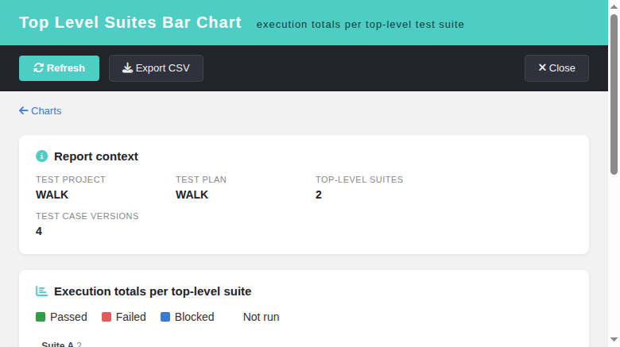

# Top Level Suites Bar Chart (Refs #1905)

Screen: `gui/templates/results/topLevelSuitesBarChart.html` ·
BFF: `api/toplevelsuitesbarchart/index.php` (`GET|HEAD ?action=init&tplan_id=N[&tproject_id=P]`) ·
Issue: #1905

## The last orphan chart endpoint

The ASIDE ledger (`docs/MODERNIZATION-STATUS.md`) showed **TODO = 0** — every screen
reachable from the ASIDE menu is already a modern Dashio page + REST BFF. An exhaustive
audit of the remaining legacy `lib/**` controllers found one last class of live legacy
renderers: the four pChart chart endpoints (`overallPieChart.php`, `platformPieChart.php`,
`keywordBarChart.php`, `topLevelSuitesBarChart.php`), which answer a PNG built by
`charts.inc.php` + `third_party/pchart`. Three of them — plus the priority bar chart,
done in **#1845** — were already modernized as standalone reports. **`topLevelSuitesBarChart.php`
was the sibling left behind:**

| Evidence | Finding |
| --- | --- |
| ASIDE/Reports hub audit | `api/resultsnav/index.php:145-169` maps every report key to a modern `gui/templates/**/*.html`; no legacy `lib/results/` URL remains |
| `charts_data` payload (`api/reports`) | returns `overall`, `by_platform`, `by_keyword`, `by_suite` — the **pixels** of all four charts are covered by `charts.html` |
| What `charts.html` does NOT give | per-suite DataTable, progress column, totals row, CSV export, rights-hardened BFF, standalone deep link |

So exactly like its **#1845** sibling (Priority Bar Chart), this is a *dedicated-screen*
modernization: the chart pixels already existed in a Chart.js section, but the legacy
endpoint's report — the exact numbers, the progress, the export — had no modern home and
no ownership-checked access.

## The legacy file and what it did

`lib/results/topLevelSuitesBarChart.php` (1.9.20) never rendered a Smarty template. It
required `charts.inc.php` and answered a **PNG** of a stacked bar chart, one bar per
top-level test suite of the plan, series pass / fail / blocked / not run, over **all
builds + all platforms**. Data came from two `tlTestPlanMetrics` helpers:
`getRootTestSuites()` (tsuite_id → name) and
`getStatusTotalsByTopLevelTestSuiteForRender()` (per-suite execution-status totals).
The legacy chart drew the map as `$item_descr = array_flip($dataSet)` then `ksort()`, so
suites are ordered **alphabetically by name** — the modern BFF reproduces that exact map
and order. A plan with zero linked test cases answered *nothing* (issue #634 parity:
`canDraw=false`), which is the `can_draw:false` branch of the BFF.

## Security gap closed

The legacy gate was `hasRight('testplan_metrics', ...)` evaluated through
`testlinkInitPage()` — a **global** right check that never tied the numbers to the plan
they belonged to, and the `tproject_id` came straight from `$_REQUEST`. The new BFF:

1. resolves the plan and derives the **owning** test project server-side;
2. checks `testplan_metrics` on that owning project **and** plan with
   `getAccess = true` (a right held only globally no longer reaches a private project);
3. treats `tproject_id` as a **client-side assertion** only — a stale deep link fails
   loudly (`project_mismatch`, 404) instead of silently reporting another project;
4. answers a documented JSON contract: `400 invalid_request`, `401 not_authenticated /
   session_expired`, `403 no_right`, `404 tplan_not_found / project_mismatch`,
   `405 method_not_allowed`, plus `nosniff` + `no-store`.

## The screen

`gui/templates/results/topLevelSuitesBarChart.html` follows the **#1845** pattern: a Dashio
shell (teal header, dark toolbar), the report context strip (project, plan, suite count,
version count), a "back to Charts" link, stacked horizontal bars drawn with **plain
CSS** (no chart library to ship), and a DataTable with the exact numbers behind every
bar plus a Totals row and a Progress (executed / total) column. Buttons: **Refresh**,
**Export CSV** (RFC 4180 quoting + UTF-8 BOM), **Close**. A footer locale switcher drives
`TLi18n`; every label is a bundle key (`tlsbc.*`, `footers.topLevelSuitesBarChart`,
`charts.openTopLevelSuitesBarChart`) in all ten locales.

Entry points:
- `gui/templates/results/charts.html` — new *Open Top Level Suites Bar Chart* entry link
  in the *Results by Top-Level Test Suite* section (beside the #1845 priority link),
  wired to the active plan;
- `lib/functions/common.php` — `$actions->topLevelSuitesBarChart` registered inside the
  `tplan_id` guard;
- the legacy endpoint `lib/results/topLevelSuitesBarChart.php` is now a session-guarded
  **302 shim** to the modern screen (document navigation → redirect; XHR/`` caller →
  `405 modern_endpoint_only`, because the legacy answer was a PNG and a 302 would render
  broken pixels; missing `tplan_id` → 400; anonymous → login redirect preserving the
  destination).

## Testing

One fresh-DB end-to-end suite was appended to `tmp/TLU_Test_Cases.md`
(`## Task — Issue #1905`). 15 steps, all PASS: full 2-suite chart render (Suite A
1 passed + 1 not-run = 50%, Suite B 1 failed + 1 blocked = 100%, totals 4 / 1 / 1 / 1 / 1,
progress 3), empty-plan state, CSV export, **Română** locale, `no_right` denial as a
restricted (role 3) user, BFF contract matrix (200/400/401/404/405), shim matrix
(302/405/400/anonymous), and the charts.html entry link. The `events` table shows no new
Error/Warning entries. Code review (subagent) over the BFF + screen + shim returned all
**OK**, no FIX items.