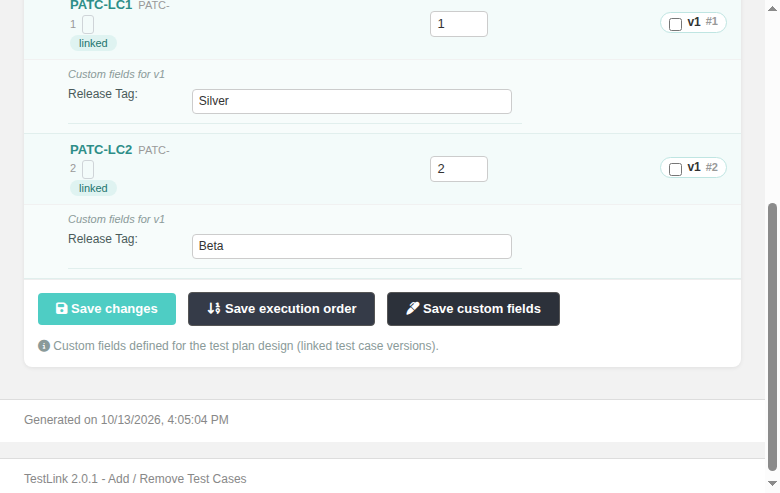
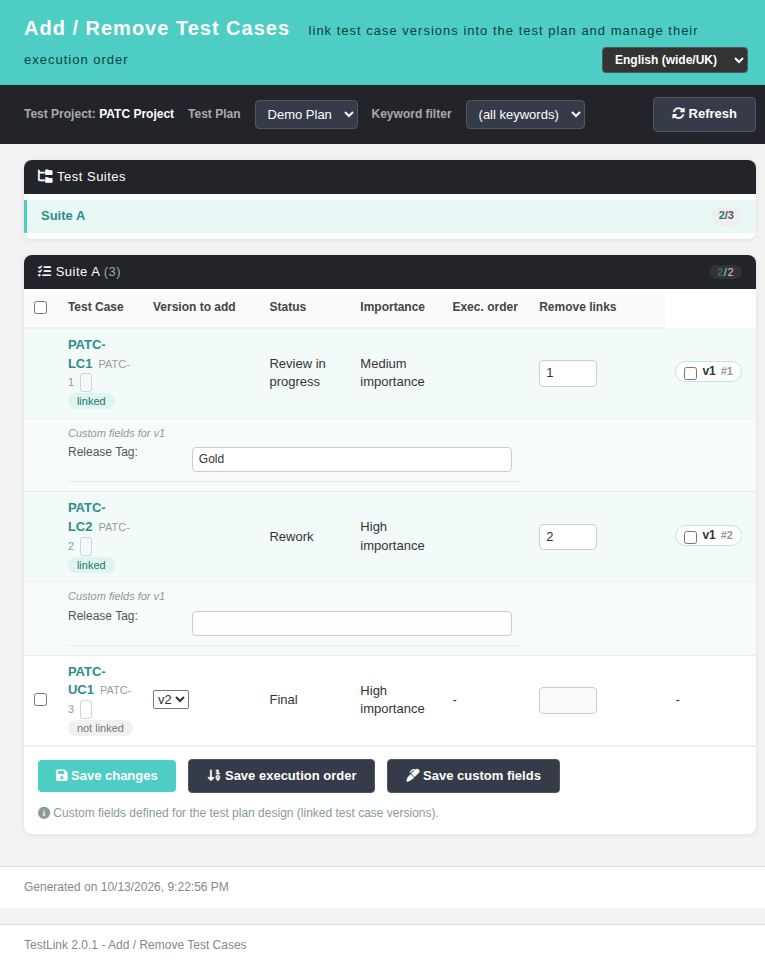
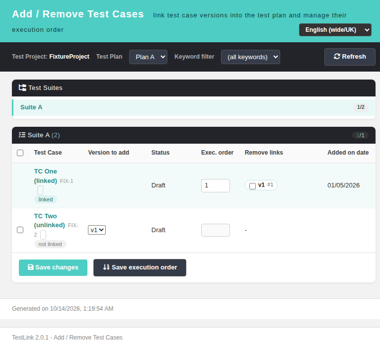
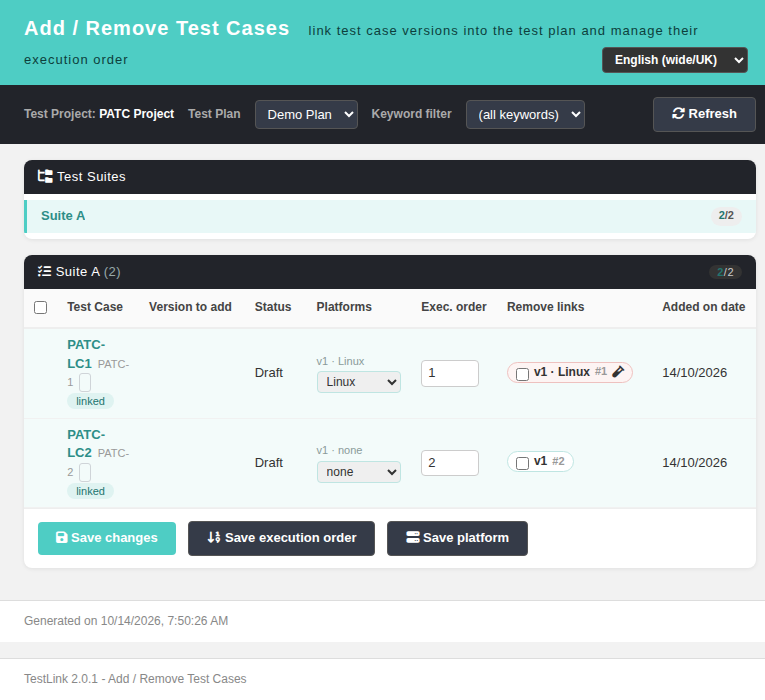

# Add / Remove Test Cases to Test Plan (planAddTC) — Wiki
The modernized **Add / Remove Test Cases** screen replaces the legacy
`lib/plan/planAddTC.php` tree-based linker. It links test case versions into a
test plan (optionally per platform), unlinks them, sets execution order and can
assign a tester + build for freshly added cases — all with the same server-side
semantics as TestLink 1.9.20 (`testplan::link_tcversions()`,
`unlink_tcversions()`, `setExecutionOrder()`).

**Path:** Test Plan > Add / Remove Test Cases (requires an active test plan)
**URL:** `gui/templates/plans/planAddTCView.html?tproject_id=<id>&tplan_id=<id>`
**BFF API:** `api/plans/index.php` (REST: GET `/planaddtc/init`, `/planaddtc/suites`,
`/planaddtc/container`; POST `/planaddtc/save`, `/planaddtc/reorder`,
`/planaddtc/savecustomfields`, `/planaddtc/save-platform`)
**Prerequisite:** `testplan_planning` right on the test project; removing links
that already have executions additionally requires `testplan_unlink_executed_testcases`.


---
## Table of Contents
1. [Screen Layout](#1-screen-layout)
2. [Linking Model](#2-linking-model)
2d. [Platform Reassignment + Save platform (Issue #1129)](#2d-platform-reassignment--save-platform-issue-1129)
3. [Executed-Link Guard](#3-executed-link-guard)
4. [Rights Model](#4-rights-model)
5. [REST API Reference](#5-rest-api-reference)
6. [i18n Keys](#6-i18n-keys)
7. [Testing](#7-testing)
8. [Bugfix — Issue #1909: column alignment for platform-less plans](#8-bugfix--issue-1909-column-alignment-for-platform-less-plans)
9. [Task — Issue #1130: per-TC execution-history + test-spec-design icons](#9-task--issue-1130-per-tc-execution-history--test-spec-design-icons)

---
## 1. Screen Layout
* Teal Dashio header: title, subtitle, locale switcher.
* Toolbar: test project picker, test plan picker (re-inits the whole screen),
  keyword filter, Refresh button.
* Left panel — suite tree with **linked/total** deep badges per suite.
* Right panel — per-suite table:
  * *ADD*: checkbox; version dropdown (active versions only, newest active
    preselected; inactive versions disabled); platform multi-select when the
    plan has platforms (nothing preselected, legacy default); execution order input.
  * **Status** column (always) and **Importance** column (only when the project
    enables test priority) — legacy `planAddTC.tpl:171-172`; both follow the
    version chosen in the row and are re-rendered when it changes (see §2b).
  * Linked rows show a remove chip `v<n> #<order>` (red dot when executed) and
    the add controls collapse into the linked state.
  * **Added on date** column (rightmost) — the link creation date of a linked
    test case (legacy `linked_ts`), blank for unlinked add-rows (see §2c).
  * Linked rows additionally render a full-width **custom-fields row** per link
    when the project has custom fields with `show_on_testplan_design`/
    `enable_on_testplan_design` (scope `testplan_design`): tag
    *"Custom fields for v<n> · <platform>"* followed by the legacy CF inputs
    (`custom_field_<type>_<cfid>_<link_id>` names, pre-filled with the values
    stored in `cfield_testplan_design_values`).
* Footer: **Save changes** (links) / **Save execution order** (reorder) /
  **Save custom fields** (CF values — visible only when at least one linked TC
  in the suite has testplan-design CFs and the user holds `testplan_planning`).
* Tester assignment block appears when `exec_assign_testcases` right is present
  and the plan has active builds: tester + build dropdowns applied to newly
  created features.

## 2. Linking Model
Payloads mirror the legacy structures exactly:
`{items:{tcId:{platId:versionId}}, tcversion:{tcId:versionId}, platform:{platId:platId}}`.
* Platform-less plans link version id under platform key `0`.
* Already-linked pairs are silently deduplicated server-side (legacy
  `getFilteredLinkedVersions` behavior).
* Reorder sends `{order:{tcversion_id: node_order}}` → `setExecutionOrder()`.



## 2a. Testplan-design custom fields (Issue #1126)
Legacy parity with `planAddTC.php doSaveCustomFields()` (lib/plan/planAddTC.php
:715-778): the BFF renders the ready-to-write inputs server-side with the exact
legacy helper (`testcase::html_table_of_custom_field_inputs` scope
`testplan_design`), so every CF type (string, combo, multi-select, checkbox,
radio, date, datetime) keeps its native input/name/value semantics. The POST
endpoint groups the submitted `custom_field_*_*_<link_id>` names by link_id
(≈ `testplan_tcversions.id`, `explode('_')` position 4, same split as legacy),
rejects links not owned by the plan, and persists each subset through
`cfield_mgr::testplan_design_values_to_db($cfvalues, null, $link_id)`.

## 2b. Workflow Status + Importance columns (Issue #1127)
The modern table dropped the two attribute columns the legacy screen rendered
(`planAddTC.tpl:311-317`). They are restored:

* **Status** — always shown; label from `tcversions.status` mapped through the
  `tcView` wording (`Draft`, `Ready for review`, `Review in progress`, `Rework`,
  `Obsolete`, `Future`, `Final`, i.e. `config_get('testCaseStatus')`).
* **Importance** — shown only when the project option `testPriorityEnabled` is
  set (`planAddTC.php:621`) — the header and the body cells are both omitted
  otherwise; labels High / Medium / Low.
* A row shows the attributes of its **linked** version, or of the version
  preselected in the dropdown for an unlinked case. Changing the version
  dropdown re-renders both cells via `updTCAttr()` — the modern twin of legacy
  `updTCAttr(tcID,tcvID)` — so it matches `specview.php:1323-1324`.



## 2c. Added on date column (Issue #1128)
The modern table dropped the link-creation-date column the legacy screen rendered
(`planAddTC.tpl:184-186` header, `:370` no-platform cell `localize_date
d=$tcase.linked_ts[0]`, `:438` per-platform cell). It is restored:

* The BFF `/planaddtc/container` now selects `TPTCV.creation_ts AS linked_ts`
  (`testplan.class.php:6076` alias `linked_ts`) and every `links[]` entry carries
  `linked_ts` (raw) plus `linked_ts_display`, formatted with the same helper the
  legacy template used (`localize_dateOrTimeStamp(..., 'date_format', ...)`,
  i.e. `%d/%m/%Y`).
* The screen renders the localized date for linked TCs. Since the modern screen
  aggregates the legacy per-platform rows into one row per test case, the cell
  joins every distinct link date; unlinked add-rows stay blank, exactly like the
  legacy `&nbsp;`.
* Cell tooltip = `paddtc.infoAddedOnDate` (legacy `info_added_on_date`).



## 2d. Platform Reassignment + Save platform (Issue #1129)
Legacy `planAddTC.php` let you reassign the platform of a test case **already
linked** to the plan: on `?edit=testsuite&id=<suite>` each linked TC whose link
had `platform_id=0` rendered a `<select name="feature2fix[<feature_id>][<tcversion>]">`
(`gui/templates/dashio/plan/planAddTC_m1.tpl:319-321`), and the header button
**Save platform** (`btn_save_platform`, `planAddTC.php:114`) posted to
`doSavePlatforms` (`:791-800`), which called
`testplan::changeLinkedTCVersionsPlatform()` (`lib/functions/testplan.class.php:3603-3626`)
to move the link **and its executions** to the chosen platform. The button only
appeared under `full_control` / `testplan_planning` (`initDrawSaveButtons()`).

The modern screen restores it:

* **Per-link `<select class="pfsel">`** — in the *Platforms* cell of each linked
  test case. Because a modern row aggregates possibly several links, one select
  is rendered per link (`{feature_id, tcversion_id, platform_id}`), preset to the
  link's current platform; options are *none* (`0`) plus every platform linked to
  the plan (`/planaddtc/container` → `platforms`). This is a strict superset of
  the legacy `platform_id=0`-only select: an already-platformed link can be
  changed too.
* **Save platform** button (`#btnSavePlatform`) — shown only when the plan uses
  platforms and there is at least one linked row. It collects only the selects
  whose value differs from the original (`data-pl`) and POSTs the changed map;
  when nothing changed it shows `paddtc.noPlatformChange` and makes no request.
* **BFF `POST /planaddtc/save-platform`** (`api/plans/index.php:1502`) — body
  `{tproject_id,tplan_id,platforms:{<feature_id>:<platform_id>}}` where
  `feature_id` is `testplan_tcversions.id` (the same key the legacy template
  used). It requires `testplan_planning`, ignores feature ids not owned by the
  plan, and rejects a target platform not linked to the plan (`400
  INVALID_PLATFORM`). For each changed link it runs the legacy two statements
  transactionally: update `testplan_tcversions.platform_id`, and move the link's
  `executions.platform_id` from the old to the new platform so existing results
  follow it. Moving a link that already carries executions requires
  `testplan_unlink_executed_testcases` (else `403 EXECUTED_PRESENT`), mirroring
  the sibling removal guard.



## 3. Executed-Link Guard
When removing links whose `executed_qty > 0` and the user lacks
`testplan_unlink_executed_testcases`, the request is rejected (403). Users that
have the right see a confirmation modal listing affected test cases; confirming
removes links **and cascades execution deletion** (same as 1.9.20).

## 4. Rights Model
| Right | Effect |
|-------|--------|
| `testplan_planning` | required on every endpoint |
| `testplan_unlink_executed_testcases` | remove executed links |
| `exec_assign_testcases` | enables tester/build assignment |

Hardening (code review round): `/planaddtc/init` validates tplan ownership,
`suites` rejects foreign recursion roots, `save` verifies every test case lives
inside the target project (parent-walk to project root), CSRF same-origin proof
required on POSTs.

## 5. REST API Reference
| Method & Route | Purpose |
|----------------|---------|
| GET `/api/plans/index.php/planaddtc/init?tproject_id=&tplan_id=` | plans, rights, keywords, platforms, builds, testers, `priority_enabled` |
| GET `/planaddtc/suites?tproject_id=&tplan_id=[&keyword_id=][&container_id=]` | suite tree w/ deep totals + linked counts |
| GET `/planaddtc/container?container_id=` | test cases of one suite: versions (incl. `status`, `importance`), links (incl. `linked_ts` + `linked_ts_display`), executed_qty, per-link `custom_fields_html`, `has_custom_fields` |
| POST `/planaddtc/save` | link/unlink pairs + optional tester/build assignment |
| POST `/planaddtc/reorder` | save execution orders |
| POST `/planaddtc/savecustomfields` | persist testplan-design CF values (grouped by link_id, owned-link check, `testplan_design_values_to_db`) |
| POST `/planaddtc/save-platform` | reassign an already-linked TC's platform (by `testplan_tcversions.id`); moves the link + its executions (legacy `doSavePlatforms`/`changeLinkedTCVersionsPlatform`) |

Errors are JSON `{status:"error",message}` with proper HTTP codes
(400 invalid input, 401 no session, 403 rights/ownership, 404 not found,
422 NO_SELECTION / INACTIVE_VERSION).

## 6. i18n Keys
`paddtc.*` keys in all 10 bundles (`en, ro, de, es, fr, it, ja, pt, ru, zh`),
plus reuse of `pv.testProject`, `common.*`. The five testplan-design-CF keys
(`paddtc.saveCustomFields`, `paddtc.cfFor`, `paddtc.cfHelp`,
`paddtc.cfNothingSaved`, `paddtc.msg.cfSaved`) were added for Issue #1126 and
`paddtc.colStatus` / `paddtc.colImportance` for Issue #1127 (which reuses
`tcview.statusN` and `search.*Importance` for the cell values).
`paddtc.addedOnDate` (column header) and `paddtc.infoAddedOnDate` (tooltip) were
added for Issue #1128. `paddtc.savePlatforms`, `paddtc.reassignPlatform`,
`paddtc.noPlatformChange` and `paddtc.msg.platformSaved` were added for Issue #1129.
`paddtc.executionHistory` and `paddtc.testSpecDesign` were added for Issue #1130
(the per-TC icon tooltips; values reused from the verified `ta2p.execHistory` /
`ta2p.design` translations so wording matches sibling screens).

## 7. Testing
Regression suites in `tmp/TLU_Test_Cases.md`: **56** (original load/rights/i18n/
navigation/add-reorder-remove/executed-guard/keyword-filter), **Task — Issue
#1126** (9/9 PASS): CF row rendering, `custom_field_*_<link_id>` naming, save
round-trip persistence, Event Viewer clean, i18n coverage gate; and **Task —
Issue #1127** (9/9 PASS): Status/Importance rendering for linked + unlinked rows,
version-change update, `priorityEnabled=0` hides the Importance column, Event
Viewer clean, i18n coverage gate; and **Task — Issue #1128** (7/7 PASS): BFF
`linked_ts`/`linked_ts_display`, Added-on-date header + linked-row date, blank
for unlinked rows, tooltip, i18n coverage gate, Event Viewer clean; and **Task —
Issue #1129** (9/9 PASS): per-link platform select preset to the link's platform,
"Save platform" button visibility, no-change toast, true reassignment (none →
Linux → Windows, DB-verified), executions follow the link, `INVALID_PLATFORM`/
`NO_SELECTION`/unauthenticated errors, Event Viewer clean; and **Task — Issue
#1130** (11/11 PASS): per-row execution-history + test-spec-design icon links,
correct hrefs/labels/glyph font, both targets open the right page, #1767 summary
button intact, Event Viewer clean, i18n coverage gate exit 0.

---
## 8. Bugfix — Issue #1909: column alignment for platform-less plans

**Defect.** For any test plan **without platforms**, the table header and body were
misaligned: `renderContainer()` hid the `Platforms` header
(`$('#thPlat').toggle(hasPlat)`, `planAddTCView.html:380`) but the row template still
emitted a platform `<td>` unconditionally (`:468`). A platform-less plan therefore
rendered **6 header cells against 7 body cells**, so `Exec. order` and `Remove links`
were shifted one column to the left and sat above the wrong cells (the remove chip had
no header at all). All test cases in such a plan are affected; the defect was
pre-existing in the screen (not introduced by #1127) and purely cosmetic — saving,
ordering and removing links were unaffected because `collectSelection()` already
branches on `hasPlat` (`add[tc]={"0":vid}`). Screenshots (before/after) live in the
GitHub Wiki page and in `docs/screenshots/issue-1909-planaddtc-*.png`.

**Fix (2 lines, `gui/templates/plans/planAddTCView.html`).**
```js
// :468 — emit the platform cell only when the plan actually has platforms
(hasPlat?'<td>'+(isLinked?'':platCell)+'</td>':'')+
// :486 — cf-row colspan = the number of visible columns
$('<td>').attr('colspan', 6+(priorityEnabled?1:0)+(hasPlat?1:0))
```
The second site (testplan-design custom-fields row) shared the same root cause:
its colspan hard-coded the platform column as always present. The correct visible
column count is `6 + importance? + platforms?` (checkbox, Test Case, version, Status,
[Importance], [Platforms], Exec. order, Remove links).

**Verified** across all four configurations — no-platforms/no-priority (6=6, cf-colspan 6),
platforms/no-priority (7=7, cf-colspan 7), platforms+priority (8=8, cf-colspan 8),
no-platforms+priority (7=7, cf-colspan 7) — plus linked and unlinked rows (add-checkbox,
version dropdown, platform multi-select render in the correct cells), the custom-fields
row, and the platform-less `collectSelection()` payload; browser console clean, Event
Viewer clean. Regression suite **Regression — Issue #1909** appended to
`tmp/TLU_Test_Cases.md` (8/8 PASS, i18n gate exit 0). Landed as `526a902cd`.

---
## 9. Task — Issue #1130: per-TC execution-history + test-spec-design icons

**Gap (legacy vs modern).** Legacy `planAddTC.tpl:247-252` (and the per-link variant
`planAddTC_m1.tpl:327-331`) rendered, next to every test case, a `history_small` span
titled `$labels.execution_history` that called `openExecHistoryWindow(tcase_id,...)`, and
an `edit_icon.png` titled `$labels.design` that called `openTCaseWindow(tcase_id)`. The
modern screen (`planAddTCView.html`) dropped both. Its third legacy item — the hover
summary `tTip()` backed by `lib/ajax/gettestcasesummary.php` — was already replaced by the
rights-checked `.sum-btn` → `tcSummary.html` popup in Issue #1767.

**Fix (client-side only, `gui/templates/plans/planAddTCView.html`).**
- Two URL helpers `execHistoryUrl(tcId)` / `designUrl(tcId)` next to `verOf()`, emitting
  the same targets as the sibling screens (`testUrgency.html:317-320`,
  `showNewestTcVersions.html:216-218`):
  `/gui/templates/execute/execHistory.html?tcase_id=<id>&tproject_id=<id>` and
  `/gui/templates/testcases/tcView.html?tcase_id=<id>&tproject_id=<id>`.
- Two icon anchors per row in the Test Case cell (rendered for linked **and** unlinked
  rows, exactly like legacy): `<i class="fas fa-clock-rotate-left">` (execution history)
  and `<i class="fas fa-pen-to-square">` (test spec design), each `target="_blank"
  rel="noopener"` with matching `title` + `aria-label` from the new i18n keys.
- `.ic-link` CSS in the Dashio palette (grey `#7a8a99` → teal `#1d6f69` on hover).

No BFF change was required: `api/plans/index.php:1143` already returns `tc_id` per item.

**Verified** with fixtures `php tmp/fixtures_1767.php` (tproject SUM1=1, plan 3, suite 5):
both icon links present on every row; hrefs correct for tcase 10/6/14; computed
`font-family="Font Awesome 6 Free"`; clicking the history icon opened
`TS1767-2 - Execution History` and the design icon opened
`TS1767 Empty Summary - Test Case Viewer`; `node --check` clean; i18n coverage gate exit 0
(7627 keys); Event Viewer clean. Regression suite **Task — Issue #1130** appended to
`tmp/TLU_Test_Cases.md` (11/11 PASS). Screenshots:
`docs/screenshots/issue-1130-plandaddtc-icons.png`, `issue-1130-exechistory.png`,
`issue-1130-tcview.png`.
